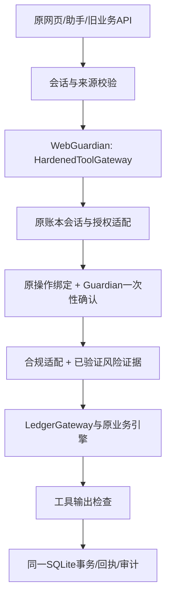

# 安全自评报告：网页安全主链整合

版本：1102.ver1。安全整链完成时间：2026-11-02T05:04:42.112881+00:00（UTC）。范围：本地虚构账户、模拟业务。本报告不是生产安全认证。

## 结论

原先“模块独立通过、网页未经过”的缺口，已通过新增网页端口接入共享HardenedToolGateway执行管线。未另建银行资金状态。历史文件按发布映射和登记变更核验，明确排除运行库；G01对服务缓存出口的修复单独登记，未改写历史基线。

本轮新入口整链58项通过（其中包含复用的原业务/安全用例，不宣称全部是新增用例）；继承后端293项通过、前端100项通过。上一轮浏览器实际完成300元模拟转账，余额38640→38340、资产128640→128340，回执可查，刷新保留；390px任务/总览未横向溢出。

## 实际架构

接入前：网页 -> LedgerGateway -> 原业务引擎/SQLite；独立Guardian模块已验证但未进入执行路径。

接入后：网页 -> 原HTTP身份/来源校验 -> IntegratedService -> WebGuardian(HardenedToolGateway) -> 当前会话/权限适配 -> 一次性确认 -> 合规适配器 -> 网页审批证据桥/风险适配器 -> LedgerGateway/原业务引擎 -> 输出检查 -> 同一SQLite事务提交与回执。



研究查询使用同一安全执行管线，但不在联网期间持有银行写锁。原公开行情后处理和控制面例外列在routes.json。不能把“业务调度经过”表述为“所有HTTP请求均经过”。

## 实现与确认绑定

- 新增security_integration，网页、知识和已有安全模块保持原样；first_agent/service.py的缓存鉴权修复已单独登记。主入口是start_security_integrated.py。
- SessionPort只接受本次服务器加载的有效会话；权限从原consent派生；LedgerAuthorizationPort重新核对会话和执行范围。strong是共享模块的本地模拟标签，不是真实强认证。
- 用户的执行请求对应原界面已经展示的具体操作；重新执行check_pending、bound_hash、权限、版本、有效期和原断言检查后，才桥接Guardian确认。没有让模型或客户端自己签发可信授权。
- 资金执行使用WebApprovalEvidenceBridge签发与工具参数、会话、原操作哈希、策略及有效期绑定的风险证据。非转账的原确认对象通过桥的通用record_from_web_operation方法适配。
- 高风险验证器只核对原操作已通过的模拟断言，未填固定True。风险证据/Guardian确认是每次请求内的一次性记录；重启防重放由原持久账本、操作状态和幂等键承担。
- 本地配置表单按请求和账本版本桥接确认，不当成金融订单审批。结算核对保留原已批准申请的状态机，不伪造新的金融审批。
- 必要审计写入失败时停止执行；本地输出检查失败会使同一SQLite事务回滚。这只适用于本地事务，不推广为真实外部银行资金可回滚。

## 权限分级说明

|级别|对象|执行要求|边界|
|---|---|---|---|
|演示样本/公开资料|会话内总览样本、产品目录、通用知识|保留原演示样本访问；业务/研究请求经过新网关|不是实名账户隐私授权|
|账户查询|账户、交易、订阅查询|原服务读取授权及有效期；共享网关前置检查|snapshot展示本会话虚构样本，不作为真实银行接口|
|订阅操作|核实、保留、取消|订阅权限；具体订阅方案确认；版本失效检查|取消只影响未来支出|
|资金操作|转账、申购、赎回|交易权限、对象金额绑定、一次性确认、已验证风险证据|累计转账超过1000元及原红色操作要求本次模拟验证|
|卡片操作|挂失、限额、限制/解锁、申请|卡片权限；原具体操作确认与模拟验证；合规与风险桥|仅虚构卡片|
|结算/回执|赎回到账、卡申请状态、未知结果核对|共享网关与原状态机；核对既有申请，不重新建立金融审批|模拟结果不是银行清算证明|
|本地配置|授权、预算、目标、任务控制|用户提交绑定到请求和当前账本版本；保留原权限规则|配置表单不伪装成交易审批|
|开发者控制|失败/未知模拟、重置、恢复|原服务端测试口令、会话绑定令牌及有效期|独立控制面；不经金融工具执行器；必须仅用于本地演示|

## 安全测试与证据

|编号|检查|证据|结果|
|---|---|---|---|
|S01|正常转账及共享网关确被调用|test_actual_shared_gateway_called_and_ledger_once|通过|
|S02|旧转账API及红色验证绑定|test_direct_transfer_api_also_passes_guardian_and_step_up|通过|
|S03|跨会话与伪造身份|test_gateway_foreign_operation_cannot_execute / test_web_identity_override_cannot_change_ledger|通过|
|S04|撤权/修改金额使旧确认失效|test_gateway_unknown_tool_and_revoked_confirmation_rejected / test_modified_amount_invalidates_old_approval|通过|
|S05|顺序及并发重复提交只扣一次|test_gateway_repeated_execute_dispatches_once / test_parallel_retry_has_one_financial_commit|通过|
|S06|安全/合规/风险拒绝与故障关闭|test_security_exception_is_closed_not_unchecked_fallback / test_compliance_denial_blocks_actual_web_handler / test_risk_denial_blocks_actual_web_handler|通过|
|S07|必要审计故障与输出拦截，本地事务回滚|test_guardian_audit_failure_cannot_move_funds / test_guardian_output_block_rolls_back_local_mutation|通过|
|S08|未知结果、赎回待到账、卡片挂失等原链路|test_unknown_is_readonly_for_customer_and_resolves_once_in_test_mode / test_subscription_purchase_and_redemption_share_balance / test_backend_card_loss_reset_and_restore|通过|
|S09|重启不复用已消费操作|test_restart_does_not_reauthorize_consumed_operation|通过|
|S10|研究查询实际经共享网关|test_public_knowledge_goes_through_guardian|通过|
|S11|实际网页300元模拟转账、回执、刷新余额|browser-verification.json及browser-*.png|通过限定路径|
|S12|普通业务JSON重复字段、非标准数值、长度/编码歧义拒绝|test_duplicate_business_json_rejected_without_execution / test_multiple_content_lengths_rejected / test_transfer_encoding_and_nonfinite_numbers_rejected|通过|
|S13|严格内容类型及请求大小限制|test_fake_content_type_and_oversize_rejected|通过|
|S14|Origin/Host、路径穿越与伪造Cookie|test_foreign_origin_and_path_traversal_denied / test_forged_cookie_does_not_disclose_account|通过|
|S15|防嵌入响应头及健康目录脱敏|test_clickjacking_headers_and_health_path_redaction|通过限定响应；不是完整XSS认证|
|S16|敏感值不进入审计内容及新增日志会话摘要|test_sensitive_values_absent_from_audit_tables|通过|
|S17|开发者登录限速及恢复|test_login_rate_limit_and_recovery|通过；公开演示口令风险保留|
|S18|四类金融业务独立核对当前权限|test_each_financial_business_rechecks_current_scope|通过4个业务分支|
|S19|6类恶意表达与5条正常表达|test_attack_variants_block_without_creating_financial_order / test_benign_financial_language_not_blocked|通过有限样例，不代表全语言覆盖|
|S20|拒绝公网监听配置|test_demo_refuses_public_listener_configuration|通过|
|G01|缓存出口当前权限、有效期、资源归属与只读重放|security_integration.test_fixes.ReplayTests|本轮复测通过|
|D01|发布映射、运行库排除、未登记缺失/篡改阻断|security_integration.test_fixes.PublicationTests|本轮复测通过|
|GEN|测试失败或发布错误时不生成新的通过报告|security_integration.test_fixes.GenerationTests|本轮复测通过|

完整日志：reports/security-integration-1101/http-tests.txt；继承测试：inherited-regression.txt与.json。截图与浏览器数值见browser-verification.json。新旧入口都在当前新服务器下测试；没有将其它仍运行的旧服务自动升级。

## 已知风险清单

|编号|等级|风险|现有控制|剩余处理|
|---|---|---|---|---|
|R01|高 / 上线阻断|身份是本地演示Cookie；Guardian使用strong这一契约标签表示模拟会话，不是真实强认证|服务端绑定会话/对象；客户与权限参数禁止由客户端指定|真实客户身份、MFA及组织角色接入前不得作为生产服务|
|R02|高 / 上线阻断|演示口令bnbu及验证示例246810公开；不具备真实客户验证强度|令牌按会话绑定、过期；登录按会话5次/分钟、本机地址20次/分钟限速；资金确认和验证绑定对象版本|真实认证与验证器由银行替换，关闭开发者入口|
|R03|高 / 上线阻断|本次资金、卡片及到账结果均为模拟，单机SQLite不是银行|同账本事务、版本、幂等、未知回执查询；并发/重启已测|真实银行适配、清算回执和分布式幂等需独立验收|
|R04|中|审计在本地SQLite；管理员可能重写或回滚全库|原审计链、独立检查点工具；Guardian必要审计写入失败不执行；新增日志用会话摘要，不记录原Cookie值|生产需独立权限存储、保留策略和外部审计锚点|
|R05|中|恶意指令/输出检测依赖规则，可能漏检或误拒绝|权限、金额、对象、确认、验证独立于文本检测；仅精确改写服务端dependencies中的策略说明以避免误报|持续加入攻击/正常语句样例，不把正则判定当语义安全证明|
|R06|中|只检验指定本地网页主链；旧启动器/其它端口不会自动升级|交付根目录只留最新启动器，旧入口归档；health标识与安全状态接口可核对|不得从旧服务成绩推断新服务，也不得把新结果用于旧服务|
|R07|中|公开行情在银行事务完成后附加；沿用原白名单解析，并非所有最终HTTP字节都由Guardian再次扫描|公共行情只传代码，不传持仓/私密输入；不得参与资金执行|第三方来源、模型和真实外发单独复核；本轮不声称实网验收|
|R08|中|105题知识答案仍未独立人工业务评分；引用通过不证明回答正确|知识与执行权限隔离；审核版检索/原文范围沿用新版保护|业务人员逐题评分；模型/适当性结论不计为本轮通过|
|R09|低 / 待扩大|本轮浏览器仅跑通模拟转账、回执、刷新和390px任务/总览，未穷尽键盘和全部浏览器|已保留原UI字节；HTTP业务与前端回归通过|补全全站无障碍、长表单、多浏览器覆盖|

## 修复与排障记录

接入时发现原输出策略说明“无需强验证”被通用注入检测当作绕过验证。仅在服务端结果的dependencies列表中，将这一个精确说明改为“本次采用基础确认”；实际高风险验证规则未放宽。

风险证据桥的网页策略版本与注册表默认策略版本不同，现将注册表明确绑定原网页POLICY_VERSION，避免有效网页审批被错误拒绝。

首次继承回归中，测试隔离方式替换了request函数，导致SSRF地址验证测试无法运行。已改为只模拟网络传输，重跑293项通过；没有修改原测试使其通过。

## 复验与交付

Windows x64 完整解压后运行“启动最新安全自评版.bat”；浏览器打开http://127.0.0.1:8808/。需要 Python 3.11+ 与 Node.js 18+。启动窗口保持运行。输入zip及旧版本均未覆盖；历史启动器在交付包history_version/launchers_before_1101归档。

复验命令：

```text
python3 -m security_integration.verify
python3 -m security_integration.regression
```

健康标识为AI_Banking_Agent_1101_Guardian_hardened_local_demo；会话建立后GET /api/security/status可核对网关名与当前会话调度次数。

模型接入另行实测。2026 年 11 月 2 日 12:33（北京时间），8808 网页收到 8811 本地模型的回复，金融 LoRA 挂载系数为 1.0。无密钥与错误密钥均返回 HTTP 401，测试问题未外发。复查记录见 reports/final-1102/local-inference.json。金融问答准确性仍待独立评分。测试中的故障/攻击是虚构数据和本地模拟，不是实网渗透。

## 验收边界

本地“安全模块进入网页业务执行管线”及指定正反向测试已完成。没有宣称独立13项工具目录的全部数据服务与网页一一合并；本次采用同一共享安全网关的网页注册端口，执行原账本业务。

真实服务接入、105题独立人工业务评分及全站完整无障碍/多浏览器验收保留为待办，不将这些任务标为通过。报告与证据可供组长复核，但不能代替组长或银行人员的独立审核。


## 本轮扩展检查与修复前后证据

本包整链检查共58项；测试函数数量不代表漏洞数量。继承业务回归执行时间：2026-11-02T05:03:43.442380+00:00。后端与前端业务回归不计入新增安全测试总数。

在独立临时服务中使用未加固的继承HTTP处理器，已复现：重复JSON字段被接受、伪造内容类型被接受、健康接口披露目录、防嵌入头缺失。只执行授权查询与汇总，未提交资金操作。修复前证据为baseline-findings.json，修复后见本轮HTTP专项用例。

TransportHardening现拒绝重复字段、非标准数值、歧义请求长度及Transfer-Encoding；严格接受application/json并限制64KiB请求、10秒读取超时。健康和分析状态接口不再返回本机目录。新增DENY框架头、限制frame-ancestors的CSP、无来源引用头及设备权限策略；没有设置完整script-src，不能据此宣称XSS全面解决。

新增日志会话标识使用session-sha256摘要；旧Guardian日志在新服务启动时转换，原账本及原会话表仍保留必要关联，不宣称数据库整体匿名化或加密。日志测试检查验证码标记、开发者令牌及新增日志里的原始会话凭证。

登录每会话5次/分钟、本机地址20次/分钟限速，重启后窗口数据仍在原SQLite中；公开演示码不是秘密，这些限制不能使其成为生产认证。新服务器拒绝0.0.0.0等非本机监听配置；本机端口也不是完整隔离边界，默认Cookie/运行库仍要求可信本机环境。

误伤样例只覆盖5条正常金融表达；6条攻击覆盖英文、零宽字符、角色伪装、隐藏脚本、跨客户查询和Base64编码。网页渲染继续使用已有转义；未实施全站XSS、依赖CVE扫描、真实模型红队或生产渗透，不把未测项标为通过。

本轮增强浏览器连接不可用，未新增界面截图或完整浏览器验收；此前转账截图只作为上一轮主链证据。增强版已通过实际HTTP健康、响应头、日志迁移及会话计数核对，见enhancement-live-verification.json。


## G01 / D01修复复测

本次测试完成时间：2026-11-02T05:04:42.112881+00:00

G01：缓存命中后，在同一账本事务内复核会话、对象、当前权限和有效期；已完成操作的重放只经过只读鉴权取回执，不再次执行或扣款。

D01：按package-manifest发布路径和authorized-changes核验历史哈希，仅允许已登记运行库缺失；篡改、未知缺失及越界映射拒绝生成。报告生成时间和测试执行时间分开记录。
