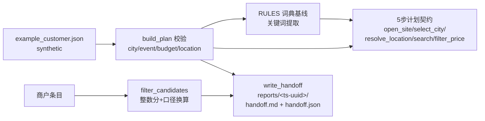

# 1111.ver2 增强版系统工程开发计划（Enhanced Engineering Development Plan）

> 2026-11-11 由用户批准。本文件是分析与路线图交付物；执行状态以 TEST_RESULTS.txt、development_log.jsonl 与后续交接为准。
> 执行约定：每 Phase 开工前核验开发额度（任一可信窗口剩余≤15%即暂停，只保存交接与审计）；未留证据不得宣称任何未实现目标完成。

## Phase 0 — 本地加固（0.5天，零外部依赖）— 本轮执行
1. README.md、启动1111本地测试.bat
2. R1 词库外置（data/lexicon.json + lexicon.py，含否定基线与内置兜底）+ R2 六个 JSON Schema + 接入校验
3. 补缺失测试；run_all_checks.py 一键回归（单测+Schema校验+词库完整性）写入 TEST_RESULTS.txt
4. 交付物：全绿回归 + 版本化词库 + Schema 契约

## Content Analysis（内容分析）

### 文件清单与角色
| 文件 | 内容 | 状态 |
|---|---|---|
| `DESIGN.md` | 9节设计文档：客户输入契约、关键词提取与千问接入、页面操作契约、预算处理、训练数据与评测设计、交接结构、验收门槛 | 设计为主，部分已实现 |
| `workflow.py` (133行) | 确定性核心：`cents()` 金额解析、`build_plan()` 需求校验+5步计划、`filter_candidates()` 单品类预算筛选、`write_handoff()` 交接生成 | 已实现 |
| `test_workflow.py` | 12项单元测试（边界150/150.01、脱敏、口径、定位等） | 全部通过（0.017s） |
| `example_customer.json` | 合成客户样例（杭州/生日聚餐/600元总额/4人），带 `synthetic:true` | 演示用 |
| `reports/20261111-.../` | 生成的 handoff.md/json，状态 planned、plan_only、live_executed:false | 真实产物 |
| `development_log.jsonl` | 八字段创作日志 | 合规 |
| `LOCAL_AGENT_HANDOFF.md` | 已实现/未实现清单，禁止把模拟通过标记为真实完成 | 诚实声明 |

### 已核实的外部事实（2026-11-11 交叉验证）
- `1102.ver3/最新版本/first_agent/external_services.py:175-183`：dianping/meituan 均为 `mode:'official_web_link', merchant_api_connected:False`，`links()` 只返回官网URL —— DESIGN.md 声明属实
- 本地模型 `F:/AI_Banking/local-ai/qwen2.5-0.5b-instruct-q4_k_m.gguf` 存在；8797端口不监听（与交接一致）
- `1111.ver1` 是无关的 C++ 银行课程演示，1111.ver2 刻意独立
- 1102.ver3 `first_agent/` 已有 intent_parser、finance_lexicon、security、server/service、reviewer_model、rag_additions 等模块 —— 是未来集成的对接面

### 当前架构

设计但未建（DESIGN.md 规划）：千问本地调用(8797, temp=0, 受限JSON+证据片段) → 浏览器执行适配器(7动作契约、每步状态回读、30s超时) → 轨迹采集(脱敏→人工审核→划分) → 适配器训练 → 两层评测(参数提取/执行成功率) → 发布门禁(预算越界与隐私外发错误=0)。

### 系统优点（应保留的资产）
1. 诚实状态纪律：plan_only、live_executed:false、keyword_source:"rule_baseline_not_qwen"、synthetic 标记 —— 强反幻觉姿态，是全项目核心价值
2. 金额工程扎实：Decimal、整数分、布尔/NaN/Infinity 拒收、150 vs 150.01 边界测试
3. 隐私设计：交接不含事件原文（有测试）、PII 不外发点评、设备定位与操作员定位严格分离
4. 验收门槛明确：DESIGN §8 列出5项阻塞，禁止在证据齐全前宣称完成

### 识别的工程缺口
| # | 缺口 | 影响 |
|---|---|---|
| G1 | 关键词为硬编码 RULES 子串匹配：否定失效（"不要蛋糕"仍出蛋糕）、多意图无排序、词库不可版本化 | 核心输入质量问题 |
| G2 | 千问客户端零代码：DESIGN §3 的 8797 调用、JSON Schema 校验、一次修复重试、needs_input 回退均为纸面 | 模型路径未去风险 |
| G3 | 执行器纯设计：7动作契约无骨架代码、无页面状态模型、无 evidence_ref 采集格式、无定位符注册表（城市点击已超时一次） | 最高风险未知项 |
| G4 | Schema 未机器化：customer/plan/merchant_item/qwen_output/trajectory 均无 JSON Schema 文件，校验靠断言 | 契约可漂移 |
| G5 | filter_candidates 输出只留 `id`，丢弃价格/口径/来源证据；单品类限制、无多品类预算分配 | 可审计性差 + DESIGN §5 已自认 |
| G6 | write_handoff 只覆盖计划字段；DESIGN §7 要求的每步接口日志/耗时/错误码/重试次数无运行时载体 | 真实运行无法回填 |
| G7 | 测试缺口：filter_candidates 无币种不匹配用例、无 CLI 测试、无目录冲突测试、无属性测试；无启动 .bat、无一键回归脚本 | 回归保障弱 |
| G8 | 训练管线零脚手架：§6 的轨迹Schema/脱敏/审核/划分/评测门禁均无代码 | 后期关键路径 |
| G9 | 运行时可观测性缺失：无逐次运行 jsonl 日志，仅最终交接 | 调试与证据链弱 |
| G10 | 抓取内容无提示注入运行时防线（§6 只把它列为训练样本）；8797 鉴权未验证 | 安全缺口 |
| G11 | 无包内 README；DESIGN 内联链接无法追溯 | 可维护性 |

## Reasoning（逐步推理）

**第一步 — 定序依据来自项目自身门槛。** DESIGN §8 与交接文件已规定完成顺序：真实客户接线 → 浏览器适配器 → 脱敏轨迹采集 → 训练 → 盲测 → 才可宣称达成。增强计划沿此门禁序列展开，补的是每级门禁缺失的工程脚手架，而非改变门禁本身。

**第二步 — 风险排序决定优先级。** (a) 浏览器执行器是风险最高未知项（城市点击已超时、控件定位符未稳定采集），应最早用只读薄切片去风险；(b) 千问客户端成本低但能并行去风险（8797未启动、Qwen2.5与Qwen3模板兼容性未证），且完全可本地测试（假服务器）；(c) 训练被轨迹采集门禁挡住，脚手架可并行建设但产出为零是诚实的；(d) 多品类预算分配是纯逻辑，立即可测，解锁真实场景。

**第三步 — 反幻觉纪律必须制度化而非口头化。** 把"禁止虚构成功"编码进结构：execution_log 每步必须带 evidence_ref 才算完成；write_handoff 从日志回填而非模板填空；schema 里 status 枚举封闭；门禁写成代码（预算越界=0、隐私外发=0 是断言不是愿望）。

**第四步 — 陷阱清单。** Windows 编码（utf-8-sig 已处理，需保持）；端口卫生（8797/8803-8807 已被占用，新服务需探测）；定位符不可持久化瞬时元素编号（需注册表机制）；与 1102.ver3 集成必须以新模块接入 first_agent，不改 external_services.py 语义（1030.ver4 的 audit 命名冲突教训）；额度规则适用于每个 Phase 开工前。

**第五步 — 增强而不重构。** 现有 workflow.py 四个函数质量良好，测试真实通过。计划以"加法"为主：外置词库、补Schema、加客户端、加执行器骨架、扩展筛选输出 —— 不推倒重写，保留12项测试为回归基线。

## Recommendations（具体改进项）

- **R1 词库外置与升级**：data/lexicon.json（trigger→search_keywords→priority→否定前缀），加载器带版本号；否定做"前缀+关键词"连续匹配基线，未可靠匹配转复核标记；RULES 保留为兜底并在 keyword_source 如实标注。
- **R2 六个 JSON Schema**：customer_input / plan / merchant_item / qwen_output / trajectory / execution_log；build_plan 与 filter_candidates 接入校验；status 枚举封闭、live_executed 恒为 false。
- **R3 `qwen_client.py`**（Phase 1）：健康探针 → chat/completions(temp=0) → 严格Schema校验 → 证据片段与本地原文核对 → 最多一次格式修复 → 回退 needs_input → 模型无权改写 city/budget。先假服务器测试再接真服务。
- **R4 `executor/` 骨架**（Phase 2）：BaseExecutor（每步后强制读页面状态）、30s超时、仅只读/幂等重试一次、evidence_ref、waiting_user 状态机、locator_registry 运行时重观测定位符。首切片只读 open_site/select_city/search。
- **R5 filter_candidates 增强**（Phase 3）：输出保留价格/口径/来源证据；新增 allocate_budget() 多品类分配 + 组合验证，纯本地逻辑+单测。
- **R6 执行日志**（Phase 3 完成）：run.jsonl append-only；write_handoff 从日志回填真实执行字段，无日志字段留空，禁止填模拟成功。
- **R7 测试与工具链**（Phase 0）：补币种不匹配、CLI、结构校验用例；启动bat；run_all_checks.py。
- **R8 训练管线脚手架**（Phase 4）：data/trajectories/{candidate,reviewed}、审核CLI、划分工具（按客户+事件模板分组防泄漏）、synthetic/observed 强制标签、评测harness + 门禁代码。
- **R9 客户来源适配器**（Phase 6）：customer_source.py 接口（操作员显式提供记录ID），禁止文件系统遍历选客。
- **R10 集成护栏**（Phase 6）：门禁全过前保持独立；集成以独立模块挂入 1102.ver3 first_agent，不改 external_services.py，方法命名先查重。

## Updated Development Plan（有序路线图）

**Phase 0 — 本地加固（0.5天，零外部依赖）**：见本文件顶部。
**Phase 1 — 千问路径去风险（1–2天）**：启动8797并按 DESIGN §3 核验 model id/鉴权/template/JSON能力并留证；qwen_client 先假服务器测试后真服务冒烟（20–30条金标准集）；交付通过率基线报告（如实含失败）。
**Phase 2 — 只读执行器薄切片（2–4天，最高风险项）**：R4骨架+locator_registry；三动作只读；攻克城市点击超时；waiting_user 状态机；每步 run.jsonl。交付：一次真实只读观测会话的完整证据链（不做任何写操作）。
**Phase 3 — 预算组合与交接回填（1天）**：R5 多品类分配+组合验证+单测；filter_candidates 输出带证据；write_handoff 从 run.jsonl 回填。交付：单测全绿 + 合成端到端交接样例。
**Phase 4 — 轨迹采集（持续，依赖 Phase 2）**：R8 脚手架+审核流程；按 §6 配比采集（150/100/80/100/80/90，共600目标）；脱敏→人工审核→划分；synthetic/observed 分报。交付：已审核轨迹库（数量如实，未审核不入训练）。
**Phase 5 — 训练与门禁评测（依赖 Phase 4）**：Qwen2.5-0.5B 独立适配器训练，原权重冻结；固定独立测试集两层评测；门禁：预算覆盖错误=0、隐私外发=0，未过不发布。交付：评测报告或"未达标"如实结论（仅日志不算训练完成）。
**Phase 6 — 接线与最终验收（依赖 Phase 5 过门禁）**：R9 客户接线；真实端到端（含授权与脱敏）；R10 集成；按 DESIGN §8 五项阻塞逐项销项，全部留证后才可输出"全部目标达成"。

**验证方式**：每 Phase 以 `python -m unittest -v` + `python run_all_checks.py` 为本地回归门槛；Phase 2 起以 run.jsonl 证据链核验；Phase 5 以固定测试集报告核验；全程 TEST_RESULTS.txt 与 development_log.jsonl 留痕。
