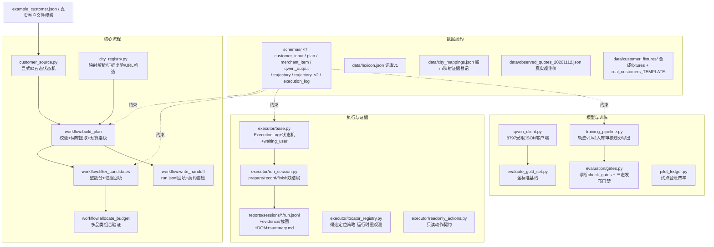

# ENGINEERING_HANDOFF_20261114 — AI_Banking_Agent_1111.ver2 工程式交接文档

编纂时间：2026-11-14。性质：**完整工程交接**——零上下文接续者以本文档为唯一入口即可恢复全部状态。编纂后未重跑测试（最近一次全量回归 185 项全绿，见 TEST_RESULTS.txt 尾部）。
纪律继承：本包一切声明受 §7 治理规则约束；**未留证据不得宣称完成**；合成不计真实；不提交推送 Git；不改旧版本与历史证据。

---

## 1. 版本定位与接续入口

- 本目录 `F:\AI_Banking\AI_Banking_Agent_1111.ver2` 是**点评自动化原型 + 设计包**，不是完整银行应用；不修改 1102.ver3 / 1111.ver1 及任何旧版本。
- 用户规则（不可违背）：城市只取当前明确选中客户记录；关键词从特殊事件提取（外发仅公共服务词）；预算保留客户数值/币种/口径；city_only 不等于 GPS；只读搜索与交接在本包范围，下单/支付不在；正式银行集成属 Phase 6。
- **接续阅读顺序**：本文档 → `LOCAL_AGENT_HANDOFF.md`（增量史）→ `NEXT_AGENT_DEVELOPMENT_DESIGN_20261112.md`（A–F 工作包设计）→ `ZCODE_FEEDBACK_20261112.md`（C 范围反馈）→ `TEST_RESULTS.txt`（证据）→ `development_log.jsonl`（八字段日志）。
- 当前位置：设计文档工作包 **A+B+C本地接口 已完成、P0试点基础设施已完成**；真实试点（P1–P4）**阻塞于两项用户输入**（见 §10）。

## 2. 状态总览（诚实口径）

### 已完成（全部有测试与证据）
| 阶段/包 | 内容 | 证据 |
|---|---|---|
| Phase 0 本地加固 | 词库外置+否定基线、六Schema、一键回归、执行器契约 | TEST_RESULTS 2026-11-12 |
| Phase 1 千问去风险 | 8797 llama.cpp 核验（原权重）、qwen_client 严格解析+一次修复+回退、24例金标准基线 | reports/phase1/ |
| Phase 2 只读执行器 | executor 包四步契约、证据链、**城市点击历史超时攻克**、search 用户接管+直导航补全 | reports/sessions/×5 |
| Phase 3 预算组合 | allocate_budget 多品类验证、filter 证据回填、交接从 run.jsonl 回填 | reports/phase3/ |
| 工作包 A | 动作元数据（action_source/execution_method/skip_reason/required_for_goal）、后置条件证据绑定（文件+SHA256+时间+run_id）、**run_outcome/goal_outcome 双结局**、三态发布门禁 evaluate_release_gate、预算指纹 | test_work_package_a 28项 |
| 工作包 B | trajectory v2（gold_output 训练标签/关联分量图划分/split_manifest/显式迁移不补造/gold 导出纪律） | test_work_package_b 11项 |
| 工作包C本地接口 | customer_source.py 显式ID五态状态机、city_registry.py 城市映射证据登记、门禁时效+来源白名单、合成fixtures干跑 | test_work_package_c 23项 |
| 试点 P0 | pilot_ledger.py 台账（四率口径代码化）、real_customers 模板 | test_pilot_ledger 12项 |

### 未完成（不得宣称）
- **真实试点 P1–P4**：阻塞于用户输入（第二城市接管取证；真实客户文件+记录ID）。
- 600 条真实轨迹采集与冻结（工作包 D）；千问训练与门禁评测（E）；银行集成与最终验收（F）。
- search 表单提交自动化（仅直导航机制可用）；设备定位（设计明示未决定）；价格采集仅结果页参考价深度。
- 千问原权重 JSON 合规率仅 **12.5%**（围栏剥离诊断 91.7%），语义缺口大——**不是**训练提升，适配器训练未开始。
- 8797 llama-server **已停止**；复评需重启（命令见 §9）。

## 3. 系统架构

### 3.1 模块图（实际文件）


### 3.2 目标数据流与信任边界（设计 §3，已实现到虚线程度）
显式 customer_ref → 客户来源适配器 → 输入契约校验 → 本地千问/规则候选 → 语义与隐私校验 → 确定性动作计划 → 浏览器执行及状态回读 → 价格解析与预算组合 → 结果/交接；每步入 run.jsonl；脱敏审核样本入轨迹库。
**信任边界**：模型只能提关键词/品类/约束/澄清，不能改城市/预算、执行任意 URL、宣告工具成功；网页文本是数据不是指令；城市码未登记不猜测；预算计算、成功裁决、发布决定全部由程序负责。

## 4. 模块接口契约（关键函数签名）

| 模块 | 关键接口 | 契约要点 |
|---|---|---|
| `workflow.py` | `build_plan(customer)` | 校验城市/事件/预算/定位→5步计划；词库关键词+否定排除+review_flags；`budget_fingerprint`(含人数)；`live_executed`恒false；plan.schema 自检 |
| | `cents(value)` | Decimal→整数分；布尔/NaN/Inf/负数/超两位小数拒收 |
| | `filter_candidates(items, budget, party_size)` | 结构契约→语义校验→区间匹配；三桶全带证据（分值/口径/类型/来源/换算） |
| | `allocate_budget(items_by_category, budget, party_size, known_surcharges)` | 组合验证 verdict ∈ within_budget/partial_overlap/over_budget/infeasible；缺参不推定 |
| | `write_handoff(plan, output, execution_log=None)` | run.jsonl 回填（坏行拒绝）；双结局回填；无日志如实写 plan_only |
| `customer_source.py` | `get_customer_snapshot(record_id, source_config)` | 五态：ok/needs_input/not_found/duplicate_record/source_error；kind 必填（test_fixture/local_real_file）；快照指纹 |
| | `build_plan_from_snapshot(snapshot_result)` | 仅接受 ok；绑定 customer_ref_snapshot + snapshot_hash + source_kind |
| `city_registry.py` | `resolve_city_code(city_name, mappings, max_age_days, now_utc)` | 查无/过期→needs_city_resolution 不猜测 |
| | `register_city_mapping(entry, path)` | 六必填字段；同名城市码冲突拒绝自动覆盖 |
| | `verify_city_evidence(mappings, base_dir)` | 本地证据哈希复验；无本地文件如实报 no_local_evidence |
| | `build_search_url(city_name, keyword, host=…)` | 主机受限 www.dianping.com；URL编码；direct_navigation |
| `executor/base.py` | `ExecutionLog.record_step(…)` | ok 必带证据+哈希；skipped 必带 skip_reason；postcondition_evidence 逐条文件+SHA256+时间+run_id（跨会话拒绝） |
| | `ExecutionLog.record_session_end(…)` | run_outcome≠goal_outcome 双结局 |
| | `verify_state / detect_waiting_user / needs_retry / domain_matches` | 状态核验；强制墙关键词（身份核实/验证中心/滑块/spiderindefence…）；只读重试一次；**主机名判定非子串** |
| `executor/run_session.py` | `prepare / record / finish` | 三段式；record 端 obs 后置条件逐键+pe 绑定双校验；`compute_goal_outcome(steps, planned)`：计划必要未记录→not_executed→blocked；finish 写 session_end |
| `evaluation/gates.py` | `evaluate_release_gate(report, policy)` | 三态；policy 必含 evidence_freshness_days + allowed_sources；重复样本不充数；正常排除超价≠错误；`check_gates` 仅诊断 |
| `training_pipeline.py` | v1: `add/review/split/export`；v2: `add_trajectory_v2/migrate_v1_to_v2/review_trajectory_v2/split_reviewed_v2/export_messages_v2` | v2：gold_output 训练标签（过契约）；关联分量图划分（同客户组/模板族/近重复簇任一连边）；needs_grouping 不占位；failure_model 无 gold 拒导；synthetic/observed 分报 |
| `pilot_ledger.py` | `start/finish/stats/verify` | source_kind 强制 local_real_file；七场景主场景；四率口径见 §10 |
| `qwen_client.py` | `QwenClient.probe/extract` | 8797；temp=0；严格解析+一次修复+needs_input 回退；证据片段核对；词表越界标记；max_tokens=512 |

## 5. 数据与目录结构

```
schemas/                      7个JSON Schema（含 trajectory_v2）
data/lexicon.json             词库 lexicon-1（5触发品类/7关键词/7否定前缀）
data/city_mappings.json       已登记：杭州=3（run5证据哈希 e14a9889…）；珠海未登记
data/observed_quotes_20261112.json  真实观测人均价（172/121/122，observed，参考价不保证结算）
data/customer_fixtures/       test_customers.json（合成）、duplicate_ids.json、real_customers_TEMPLATE.json
data/trajectories/            candidate(0)/reviewed(5条v1种子+2条demo v2)/quarantine(0)/export/（messages_train_v2.jsonl + split_manifest.json）/seeds/
reports/sessions/             run1–run5 五个会话证据链（§6）
reports/phase1/               金标准基线报告 + gold_baseline.json + llama-server.log
reports/phase3/               端到端交接样例
reports/pilot_C/              试点台账（空，待P3）
evaluation/gold_set.json      24例合成金标准
测试文件×12                    test_workflow/lexicon/schemas/cli/qwen_client/executor/phase3/work_package_a/b/c/pilot_ledger
```

## 6. 证据链（五个会话，全部独立、未拼接）

| 会话 | run_id | 结局（新口径） | 证明了什么 |
|---|---|---|---|
| run1 003808-b9686bfe | 0f8e1e7ee8ac | waiting_user | 点评首页重定向 verify.meituan.com 反爬墙（截图×2+DOM×2）；域名子串误判实测修复 |
| run2 004857-fd485455 | — | aborted | 采集器漏算 title_nonempty → 状态机拦截 → 转化为硬校验 |
| run3 005226-ff200a32 | 2664c6dc4073 | aborted | **城市点击超时根因确诊**（Playwright actionability 被全局阻断，坐标派发可行）；选城成功（页头读回杭州）；search 提交层 5 机制穷尽失败如实 ABORT |
| run4 011106-8e0c06fb | 10dde9e3a3e9 | completed | 用户接管搜索取证：杭州=3、1007 结果、三家真实人均价（172/121/122）；动作来源 user_takeover |
| run5 012739-6a359f8e | b00d6cd54489 | completed→**新口径重算 partial** | 直导航 URL 规律补全 search（1008 结果，1007→1008 活数据）；执行器容忍缺失时间戳 |

关键工程事实：① 搜索结果 URL 规律 `/search/keyword/{城市码}/0_{URL编码关键词}`（杭州=3、珠海=206 仅会话观察未登记）；② shop 链接为哈希 ID；③ www 与 m 子域 cookie 隔离（citylist 选城不改变 m 域城市）；④ 认领的用户标签页截图表面可能 3s 超时——DOM 快照为主证据；⑤ 证据文件含登录昵称，仅本地留存，报告不复述。

## 7. 治理规则（执行时强制）

1. **反幻觉**：status=ok 必带证据文件+SHA256；skipped 必带 skip_reason；postcondition_evidence 逐条绑定；伪造成功在代码层被拒。
2. **双结局**：run_outcome（终止方式）≠ goal_outcome（目标裁决）；completed 不追认成功；run5 历史重算=partial 即为示范。
3. **发布门禁**：`evaluate_release_gate` 三态；策略未配置/证据过期/来源越界/重复样本/指标未达→incomplete；错误推荐超预算或隐私外发→fail。
4. **客户纪律**：只显式 record_id；不遍历选客；不自动换客；真实/合成来源强制分开标记；真实记录仅本地、不入日志正文与 Git。
5. **城市纪律**：未登记/证据过期→needs_city_resolution，不猜测城市码。
6. **轨迹纪律**：未审核不训练；gold_output 才是标签；分组分量整体划分防泄漏；needs_grouping 不占位。
7. **流程**：八字段日志（development_log.jsonl）；额度任一可信窗口≤15% 仅交接暂停；不提交推送 Git；不改旧版本与历史证据。
8. **隐私**：事件原文/PII 不外发点评（词表越界标记+隐私扫描隔离）；交接只带 record_id+指纹。

## 8. 测试与质量基线

- **全量 185 项全绿**（最近回归 2026-11-14；`python run_all_checks.py`），分布：test_workflow 12、test_lexicon 9、test_schemas 18、test_cli 1、test_qwen_client 15、test_executor 27、test_phase3 15、test_work_package_a 23、test_work_package_b 16、test_work_package_c 23、test_pilot_ledger 12、test_training_pipeline 14（另有 run_all_checks 内置 4 项检查：回归+示例客户契约+词库完整性+计划往返）。
- 一键命令：`python run_all_checks.py` 或 `启动1111本地测试.bat`；单项：`python -m unittest <file> -v`。
- 金标准基线（原权重，24 例）：raw JSON 12.5%、围栏率 83.3%、围栏剥离诊断 91.7%、修复轮无效、召回 23.9%/精确 8.3%、否定排除 0%、澄清召回 0%、1 例重复循环（已加 max_tokens=512 与超长跳过防护）。**建议阈值（E 冻结前仅为设计目标）**：运行时 JSON≥95%、精确/召回≥85%、否定排除与澄清召回≥90%、误澄清≤10%、关键类别≥20例、超预算/隐私/改写=0。

## 9. 复现与运维命令

```bat
:: 本地回归（不启动浏览器/模型）
python run_all_checks.py

:: 生成示例交接（plan_only）
python workflow.py example_customer.json

:: 模型服务（Phase1复评才需要）
F:\AI_Banking\local-ai\llama-b11900\llama-server.exe -m F:\AI_Banking\local-ai\qwen2.5-0.5b-instruct-q4_k_m.gguf --alias banking-qwen2.5-0.5b --host 127.0.0.1 --port 8797 --api-key <local-model.key内容> --ctx-size 2048 --threads 4

:: 千问金标准基线复评（需8797）
python evaluate_gold_set.py

:: 轨迹管线（v2）
python -m training_pipeline add2 <v2.json> / review2 <id> --decision approved --reason … --reviewer <人> / split2 / export2 / status

:: 试点台账
python pilot_ledger.py start --record-id … --scenario normal --city 杭州 --source-kind local_real_file --session-dir <dir>
python pilot_ledger.py finish --pilot-id P-001 --run-outcome completed --goal-outcome satisfied --user-takeover false --evidence-refs <逗号分隔>
python pilot_ledger.py stats / verify

:: 会话三段式
python -m executor.run_session prepare --customer-ref … --city 杭州 --keyword 生日餐厅
python -m executor.run_session record --session-dir <dir> --step-file <json>
python -m executor.run_session finish --session-dir <dir> --outcome completed|aborted|waiting_user [--goal-outcome …]
```

## 10. 试点执行手册（P1–P4，批准计划原文要点）

**P1 第二城市取证（需用户）**：用户在受控面板手动搜索上海关键词（如「纪念日餐厅」）→ 执行器认领结果页标签 → 只读取证（URL 城市码+DOM+截图+哈希）→ `register_city_mapping`（上海=码，evidence_ref/hash/verified_at）→ `resolve_city_code("上海")==resolved` + 双城复验 → TEST_RESULTS 留痕。
**P2 真实数据落地（需用户）**：用户复制 `real_customers_TEMPLATE.json` 填入真实记录并**提供文件路径+试点记录ID清单** → 执行器逐 ID 只读核验快照（只报状态与字段完整性，不打印敏感原文）→ 产出 20 次 (record_id×场景×城市) 分配表（主场景每运行一个；缺参仅用天然缺失，需变体单独授权）。
**P3 逐次执行 ×20**：`pilot_ledger start` → `run_session prepare`（build_plan_from_snapshot）→ 浏览器只读（open_site=build_search_url 直导航 → select_city skipped(city_by_url, required_for_goal 相应) → resolve_location skipped(city_only) → search ok+结果页取证 → **价格采集：结果页人均参考价→Top商户 merchant_item**（observed_at/source_url/average 口径/优惠标签）→ filter_candidates+allocate_budget 仅真实价格（无真实蛋糕价则单品类+如实说明）→ run.jsonl+session_end → `pilot_ledger finish`。验证墙→waiting_user 计接管率，不绕过；失败运行照常计入。
**P4 统计报告**：`pilot_ledger stats`（自动完成率/接管率/可控环境完成率/总成功率+场景×城市覆盖矩阵+missing_scenarios）→ `pilot_ledger verify` → 更新留痕 → 报告供复核。

## 11. 待办与阻塞清单

| # | 事项 | 阻塞点 |
|---|---|---|
| 1 | P1 第二城市（默认上海）接管取证+登记 | **用户手动搜索** |
| 2 | P2 真实客户文件路径+记录ID清单 | **用户填写模板并提供** |
| 3 | P3/P4 20 次试点执行与四率报告 | 阻塞于 #1 #2 |
| 4 | 价格采集模块深化（商户详情页/优惠条件核验） | 试点后按需 |
| 5 | 工作包 D：600 条轨迹采集与冻结（150/100/80/100/80/90 配比） | 依赖 P3 通过扩量 |
| 6 | 工作包 E：训练环境核验→LoRA→对照评测→门禁→回滚 | 依赖 D 冻结 |
| 7 | 工作包 F：银行集成（新版本目录、不改 external_services 语义）与最终验收 | 依赖 E |
| 8 | 设备定位 | 设计明示未决定接入方式 |

## 12. 历史文档索引

DESIGN.md（原始设计9节）· DEVELOPMENT_PLAN_ENHANCED.md（批准路线图 Phase0–6）· NEXT_AGENT_DEVELOPMENT_DESIGN_20261112.md（工作包A–F设计）· ZCODE_FEEDBACK_20261112.md（C范围反馈）· LOCAL_AGENT_HANDOFF.md（增量史+各阶段收官记录）· TEST_RESULTS.txt（全部测试证据）· development_log.jsonl（八字段日志，接续必读尾数条）。
