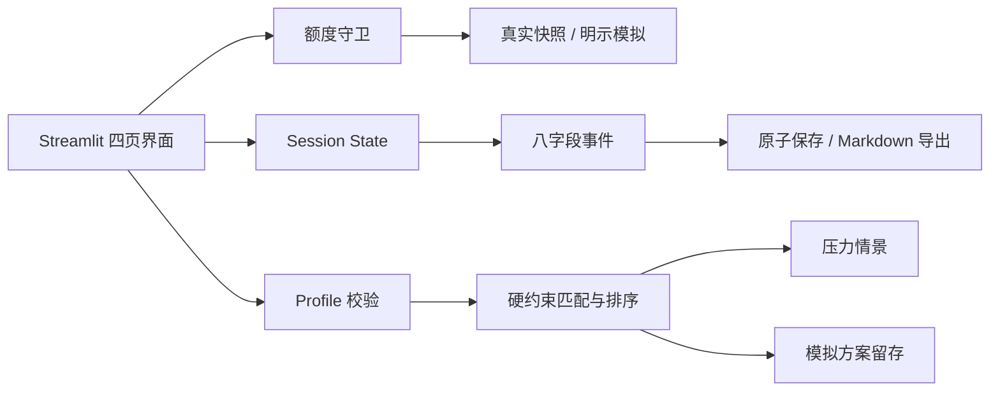

# Banking Agent：财务仪表盘与个性化产品匹配

交付日期：2026年10月18日（Asia/Shanghai）。配套代码：[dashboard_ui.py](dashboard_ui.py)；创建日志：[creation_log.json](creation_log.json)。

## 1. 产品定位与实现范围

面向个人客户的财务规划演示界面：从现金流出发，明确可规划资金，比较产品约束，再验证突发支出和收入延迟。核心创新表达是“让产品匹配考虑未来现金需求，并用情景检验解释选择”。

当前实现为本地Streamlit原型，包含四个完整页面、四个虚构产品、可解释匹配、压力情景、模拟方案留存和日志导出。所有账户、流水、风险等级和产品条款为教学设定；没有实时行情、收益预测、真实申购、账户认证或LLM调用。前后端接口设计在本文定义，尚未完成编排器接入。本次上传同时包含独立推荐模块，两者目前分别运行，尚未统一产品目录与接口。

## 2. GitHub参考与独立实现

| 已查阅参考 | 参考内容 | 本项目采用方式 |
|---|---|---|
| [streamlit/demo-stockpeers](https://github.com/streamlit/demo-stockpeers) | 股票同组比较的Streamlit应用；仓库标示Apache-2.0 | 借鉴并排比较的交互思路，比较风险、锁定期和最低金额；不引入股票数据或复制源码 |
| [edofe99/streamlit-finance-tracker](https://github.com/edofe99/streamlit-finance-tracker) | 收入、支出、账户余额概览与流水查看 | 借鉴先看概览、再展开明细的层次；未确认其可复用许可，故不复制代码或素材 |
| [Streamlit官方多页文档源码](https://github.com/streamlit/docs/blob/main/content/develop/concepts/multipage-apps/overview.md) | 页面组织与共享框架 | 单文件以页面函数和统一侧栏组织，后续可拆分为`st.Page/st.navigation` |

上述链接为本次实际检索的参考，不是占位链接；没有据此声明这些项目提供本项目的匹配算法。界面、约束和额度守卫独立编写。

## 3. 信息架构与页面布局

```text
┌─────────────────┬─────────────────────────────────────────┐
│ Banking Agent   │ 页签说明 / 标题 / 合成数据标识             │
│                 │                                         │
│ 财务总览        │ 可用现金 | 预留现金 | 可规划金额 | 方案数   │
│ 产品匹配        │                                         │
│ 情景验证        │ 六个月收支图          下一步指引           │
│ 方案与活动      │                                         │
│                 │ 可展开流水 / 数据口径                     │
│ 额度状态        │                                         │
│ 暂停并保存      │                                         │
└─────────────────┴─────────────────────────────────────────┘
```

| 页面 | 主要组件 | 用户任务 |
|---|---|---|
| 财务总览 | 四个指标、收支柱状图、引导卡、流水明细 | 理解现金与必要储备，进入匹配 |
| 产品匹配 | 画像输入、预算提示、并排产品卡、排除原因、确认区 | 修改条件、生成、比较、选定与留存 |
| 情景验证 | 两个压力滑块、可动用现金、需求和缺口 | 检查临时支出与未来收入延迟时是否仍有现金 |
| 方案与活动 | 已保存方案、历史条件标识、事件表、下载按钮 | 回看依据并导出方案或完整会话 |

总览中的历史图固定使用合成样本；匹配输入是可修改的情景假设。两者在界面上明确区分，防止修改假设时把原始流水误写为真实发生的数据。

## 4. 个性化金融产品匹配流程

### 4.1 输入与资金约束

用户填写可用现金、每月必要支出、近期其他义务、储备月数、计划金额、资金使用期限、风险偏好、风险承受能力和排序偏好。

计算层使用整数分：

```text
预留现金 = 必要月支出 × 储备月数 + 近期其他义务
可规划上限 = max(0, 当前现金 − 预留现金)
风险上限 = min(风险偏好, 风险承受能力)
```

三个月储备仅是可调整的演示默认值。近期其他义务不包含已计入必要月支出的同一笔费用，接入真实账本时需由后端避免重复计算。

### 4.2 筛选、解释与排序

每个产品先通过四项硬约束：计划金额达到最低金额、计划金额不超过可规划上限、风险不超过上限、锁定期不超过用款期限。不满足时逐条显示原因；允许全部产品均不匹配。

通过筛选后按用户偏好排序：流动性优先按锁定期再按风险；风险优先反过来；期限贴合按与用款期限的距离再按风险。同条件用产品ID稳定排序。未实现收益预测、收益优先排序或“匹配成功概率”。

### 4.3 选择、确认和留存

1. 提交条件并生成匹配结果。
2. 查看匹配卡及被排除产品的理由。
3. 选择一个方案；可先进入情景验证。
4. 勾选“模拟方案、不会申购或扣款”。
5. 保存时重新检查额度及当前约束，创建方案快照。
6. 下载JSON或完整Markdown，在方案页面回看。

画像、金额、所选产品、策略或目录版本变化会使旧匹配/确认失效。保存ID绑定画像、产品和版本，重复保存同一方案不新增记录。若情景证据变化，再次确认保存会更新同一方案，保留原创建时间，新增更新时间并在日志中保留更新前后内容。历史方案保留原条件，并在条件变化后标为历史快照。保存仅记录方案，不改变现金或持仓。

### 4.4 压力情景

压力参数为额外临时支出和未来收入延迟产生的额外缓冲需求。锁定产品的计划金额不计入即时可动用现金；无锁定产品在演示假设下可动用。延期收入不冲销已入账的历史现金。

该模型未模拟赎回到账延迟、市场价格、税费或违约。接入真实目录时，锁定期限和到账日应共同约束用款日期。压力结果变化不自动改写基线账户；修改滑块后旧结果失效，需要重新运行。压力参数独立保存在会话状态中，跨页导航不会重置。结果绑定画像摘要、产品ID及两项压力参数，只有全部一致才可附入当前方案。

## 5. UI/UX设计规范

| 项目 | 规范 |
|---|---|
| 背景与表面 | 浅灰绿`#F3F6F5`，白色内容卡；信息层次靠留白、边框和标题 |
| 导航 | 深蓝绿`#102E36`侧栏；四个稳定入口，当前页由原生单选状态标识 |
| 主色 | 青绿`#087E70`，用于主操作及正向状态；警告同时有文字说明 |
| 字体 | 本地系统字体，清晰中文标题与数值，不加载外部字体 |
| 布局 | 桌面四指标、双栏内容；小屏收窄内边距并沿用Streamlit自适应排列 |
| 表单 | 显式标签、合理范围、整数金额；每次条件变更清空旧结果 |
| 图表 | 收支分组柱形、固定颜色映射、工具提示；另有可读的数据口径与明细 |
| 操作 | 每一区域一个主要动作；方案确认与选择相邻；暂停仍允许导出 |
| 空与错误状态 | 没有方案、全部不匹配、缺少产品选择、额度异常、磁盘保存失败均有说明 |

无真实收益曲线、排行榜或促销倒计时。产品卡优先展示条件和限制。原生控件保留键盘操作；颜色不作为唯一状态信号。正式发布仍需专门进行屏幕阅读器与多尺寸设备验收。

项目根目录的[主题配置](../.streamlit/config.toml)统一浅色背景、控件文字和青绿主色，避免宿主默认深色主题与浅背景混用。采用[Streamlit官方主题配置方式](https://docs.streamlit.io/develop/concepts/configuration/theming)，从项目根目录启动时加载；页面顶部为固定工具栏预留空间。组件宽度采用Streamlit 1.66的`width='stretch'`。

## 6. 代码架构与集成框架



单个`.py`包含纯计算函数、会话状态与页面函数，便于直接运行；未来按`domain/`、`services/`、`pages/`、`adapters/`拆分即可。纯计算层不依赖浏览器输入状态，保存处理器再次验证，避免只依赖按钮禁用。

| 后续边界 | 建议职责与契约 |
|---|---|
| C：前端 | 画像编辑、解释展示、状态与错误交互 |
| T：编排与权限 | 认证主体、任务生命周期、工具调度；真实确认绑定不可由前端自行颁发 |
| A：后端 | 账户事实、产品目录版本、持久化计划、权限与查询接口 |
| B：数据与量化 | 资金口径、产品事实、情景模型及环境生成器 |
| D：RAG与测试 | 产品来源证据、约束用例、排除理由与材料核验 |

建议后端返回`profile_version/catalog_version/policy_version`，匹配结果携带输入摘要与原因；前端确认提交这些版本及选定产品，服务端重新授权及校验。此表为接入设计，当前没有实现这些网络API。

## 7. 五小时额度与中断处理

### 7.1 本次开发监测

开发期间通过宿主工具读取真实Codex当前300分钟窗口，周期检查并保留观察记录。首次读数为92%剩余。用户本次要求为**低于10%**停止，因此10%本身允许继续；不使用每周窗口替代五小时判断。

采样不是硬实时推送；检测到触线后应停止新设计、代码及测试，只进行已有结果封存。本文不把Codex用量推算为所有ChatGPT Plus功能的通用额度。

### 7.2 UI运行时

`BANKING_QUOTA_FILE`指定可信宿主快照时启用真实模式。快照须包含`source=codex_host`、`scope=codex`、`window_minutes=300`、`remaining_percent`、带时区的`observed_at`。百分比使用剩余值，不是已用值；快照超过90秒、超过未来5秒、字段无效或读取失败即停止。

UI使用每5秒运行的[Streamlit fragment](https://docs.streamlit.io/develop/api-reference/execution-flow/st.fragment)，并在匹配、选定、压力计算和保存操作前检查。该轮询只在会话活跃时运行，独立脚本不能直接读取本聊天工具；长期真实监测需要宿主持续刷新文件。路径未设置时明确进入**模拟额度**模式，可用`BANKING_DEMO_QUOTA`验证边界。

停止状态锁存，额度恢复不会自动续跑。中断页保留下载入口，Markdown包括当前页面、画像、未提交控件值、匹配结果、选择、压力结果、已保存方案、版本、额度及全量八字段日志。

磁盘快照按随机会话ID隔离，使用临时文件、`fsync`和原子替换。保存失败会显示错误并保留浏览器下载备份；磁盘快照不等于自动恢复服务。浏览器会话关闭后内存状态可能丢失，真实部署还需用户认证、持久化存储、访问控制、保留期限和删除策略。

## 8. 安装与启动

在项目根目录`F:\AI_Banking`运行，并保留`.streamlit/config.toml`以加载配套主题：

```powershell
python -m venv .venv-dashboard
.\.venv-dashboard\Scripts\python.exe -m pip install -r Dashboard\requirements.txt
.\.venv-dashboard\Scripts\python.exe -m streamlit run Dashboard\dashboard_ui.py
```

默认离线演示不需要API密钥。启用宿主真实额度文件：

```powershell
$env:BANKING_QUOTA_FILE = 'F:\AI_Banking\.work\dashboard\quota_snapshot.json'
.\.venv-dashboard\Scripts\python.exe -m streamlit run Dashboard\dashboard_ui.py
```

该文件必须正在被可信宿主刷新；本次开发监测结束后，快照会过期，应用将按设计暂停。独立演示可移除这一环境变量。

验证低额度中断：

```powershell
$env:BANKING_DEMO_QUOTA = '9.99'
.\.venv-dashboard\Scripts\python.exe -m streamlit run Dashboard\dashboard_ui.py
```

开发测试命令：

```powershell
.\.venv-dashboard\Scripts\python.exe -m unittest discover -s Dashboard\tests -v
```

## 9. 验证状态

v1.2已完成。Streamlit 1.66.0下29项自动化测试全部通过（16核心规则测试、13真实Streamlit AppTest），耗时7.088秒。覆盖四页导航、匹配边界、确认失效、重复保存、情景证据更新、跨页参数保持、低额度及不可用额度停止、日志与上下文导出。测试产生的bare-mode ScriptRunContext提示不影响结果，旧宽度参数弃用提示已消除。

浏览器在1280×720视口实际走通总览→生成2个匹配项→选择90天计划→情景验证→确认保存→方案与活动；返回情景仍保留结果。总览显示1个方案，现金仍为154300元。配套主题已验证：标签、按钮和提示可读。预览：[财务总览](dashboard_overview.png)、[情景验证](dashboard_scenario.png)。

本地预览服务已关闭，可按第8节重新启动；默认显示模拟额度100%，它不代表本次开发的真实Codex额度。真实监测记录附在下一节。此前额度中断情况保留于creation_log.json，属于历史记录。

当前范围内无未完成的实现步骤。全设备适配、屏幕阅读器、正式权限与真实产品/账户接入仍属后续工程；未声称已经过生产金融场景验证。

## 10. 完整创建日志

每条事件严格保留八个字符串字段；按实际时间排序。

<!-- ACTUAL_LOGS -->

### 001 · quota_observed

```json
{
  "user_id": "T/C",
  "intent": "quota_observed",
  "tool": "Codex usage limits",
  "input": "监测当前五小时窗口；严格低于10%停止。",
  "output": "{\"source\": \"codex_host\", \"scope\": \"codex\", \"observed_at\": \"2026-10-17T16:08:50Z\", \"window_minutes\": 300, \"remaining_percent\": 78, \"resets_at\": 1792262874}",
  "risk_check": "未触发低于10%的停止条件。",
  "approval": "READ_ONLY",
  "timestamp": "2026-10-17T16:08:50Z"
}
```

### 002 · v0.1 需求、参考与额度边界

```json
{
  "user_id": "T/C",
  "intent": "v0.1 需求、参考与额度边界",
  "tool": "Codex / Python / Streamlit",
  "input": "设计依据：沿用现金流约束的产品匹配方向，界面应先说明可用资金再解释产品选择。采用Streamlit以适配五人学生团队的Python技术栈。只参考开源交互模式，不复制未确认许可的代码。额度按当前300分钟窗口判断，最新要求为严格小于10%停止。",
  "output": "确认GitHub参考streamlit/demo-stockpeers和edofe99/streamlit-finance-tracker，并阅读Streamlit fragment和AppTest官方文档。确定总览、产品匹配、情景验证、方案与活动四页。开始时真实五小时额度剩余92%，已启动周期监测。当前本地Orchestrator文件为空，本次不声称已经集成后端。",
  "risk_check": "所有产品及账户为合成演示；实际额度与演示模式分开。虚拟环境首次初始化受沙箱临时目录限制，已按工具授权流程完成pip初始化。",
  "approval": "用户授权本地设计、代码、测试及日志；不代表真实金融交易授权。",
  "timestamp": "2026-10-17T16:08:53.566909+00:00"
}
```

### 003 · quota_observed

```json
{
  "user_id": "T/C",
  "intent": "quota_observed",
  "tool": "Codex usage limits",
  "input": "监测当前五小时窗口；严格低于10%停止。",
  "output": "{\"source\": \"codex_host\", \"scope\": \"codex\", \"observed_at\": \"2026-10-17T16:10:28Z\", \"window_minutes\": 300, \"remaining_percent\": 70, \"resets_at\": 1792262874}",
  "risk_check": "未触发低于10%的停止条件。",
  "approval": "READ_ONLY",
  "timestamp": "2026-10-17T16:10:28Z"
}
```

### 004 · quota_observed

```json
{
  "user_id": "T/C",
  "intent": "quota_observed",
  "tool": "Codex usage limits",
  "input": "监测当前五小时窗口；严格低于10%停止。",
  "output": "{\"source\": \"codex_host\", \"scope\": \"codex\", \"observed_at\": \"2026-10-17T16:11:38Z\", \"window_minutes\": 300, \"remaining_percent\": 68, \"resets_at\": 1792262874}",
  "risk_check": "未触发低于10%的停止条件。",
  "approval": "READ_ONLY",
  "timestamp": "2026-10-17T16:11:38Z"
}
```

### 005 · quota_observed

```json
{
  "user_id": "T/C",
  "intent": "quota_observed",
  "tool": "Codex usage limits",
  "input": "监测当前五小时窗口；严格低于10%停止。",
  "output": "{\"source\": \"codex_host\", \"scope\": \"codex\", \"observed_at\": \"2026-10-17T16:12:53Z\", \"window_minutes\": 300, \"remaining_percent\": 67, \"resets_at\": 1792262874}",
  "risk_check": "未触发低于10%的停止条件。",
  "approval": "READ_ONLY",
  "timestamp": "2026-10-17T16:12:53Z"
}
```

### 006 · quota_observed

```json
{
  "user_id": "T/C",
  "intent": "quota_observed",
  "tool": "Codex usage limits",
  "input": "监测当前五小时窗口；严格低于10%停止。",
  "output": "{\"source\": \"codex_host\", \"scope\": \"codex\", \"observed_at\": \"2026-10-17T16:13:58Z\", \"window_minutes\": 300, \"remaining_percent\": 59, \"resets_at\": 1792262874}",
  "risk_check": "未触发低于10%的停止条件。",
  "approval": "READ_ONLY",
  "timestamp": "2026-10-17T16:13:58Z"
}
```

### 007 · v0.2 实现四页界面与可解释匹配

```json
{
  "user_id": "T/C",
  "intent": "v0.2 实现四页界面与可解释匹配",
  "tool": "Codex / Python / Streamlit",
  "input": "设计依据：页面先给现金流概览，匹配页先硬过滤再按流动性、风险或期限排序，不生成无法解释的收益分数。方案绑定画像、产品、目录版本及规则版本，任何条件变化撤销旧结果与确认。选择青绿与深蓝配色、原生表单与图表，降低交互复杂度。",
  "output": "新增Dashboard/dashboard_ui.py，包含Profile、Product、匹配、压力计算、模拟方案、原子检查点、五小时额度读取与四页UI；默认目录4个虚构产品。实现严格低于10%停止、快照90秒失效停止、fragment每5秒轮询和各操作前检查；暂停时输出包含全日志的Markdown。正在安装Streamlit并准备功能测试。",
  "risk_check": "未接入真实产品、银行账户、交易或LLM；风险等级与储备规则为可调教学假设。额度离线演示明确标识；真实模式需可信宿主持续更新文件。安装依赖的沙箱网络阻断已按授权流程重试。",
  "approval": "用户授权本地设计、代码、测试及日志；不代表真实金融交易授权。",
  "timestamp": "2026-10-17T16:14:33.232923+00:00"
}
```

### 008 · quota_observed

```json
{
  "user_id": "T/C",
  "intent": "quota_observed",
  "tool": "Codex usage limits",
  "input": "监测当前五小时窗口；严格低于10%停止。",
  "output": "{\"source\": \"codex_host\", \"scope\": \"codex\", \"observed_at\": \"2026-10-17T16:15:04Z\", \"window_minutes\": 300, \"remaining_percent\": 53, \"resets_at\": 1792262874}",
  "risk_check": "未触发低于10%的停止条件。",
  "approval": "READ_ONLY",
  "timestamp": "2026-10-17T16:15:04Z"
}
```

### 009 · quota_observed

```json
{
  "user_id": "T/C",
  "intent": "quota_observed",
  "tool": "Codex usage limits",
  "input": "监测当前五小时窗口；严格低于10%停止。",
  "output": "{\"source\": \"codex_host\", \"scope\": \"codex\", \"observed_at\": \"2026-10-17T16:16:28Z\", \"window_minutes\": 300, \"remaining_percent\": 43, \"resets_at\": 1792262874}",
  "risk_check": "未触发低于10%的停止条件。",
  "approval": "READ_ONLY",
  "timestamp": "2026-10-17T16:16:28Z"
}
```

### 010 · quota_observed

```json
{
  "user_id": "T/C",
  "intent": "quota_observed",
  "tool": "Codex usage limits",
  "input": "监测当前五小时窗口；严格低于10%停止。",
  "output": "{\"source\": \"codex_host\", \"scope\": \"codex\", \"observed_at\": \"2026-10-17T16:17:44Z\", \"window_minutes\": 300, \"remaining_percent\": 39, \"resets_at\": 1792262874}",
  "risk_check": "未触发低于10%的停止条件。",
  "approval": "READ_ONLY",
  "timestamp": "2026-10-17T16:17:44Z"
}
```

### 011 · quota_observed

```json
{
  "user_id": "T/C",
  "intent": "quota_observed",
  "tool": "Codex usage limits",
  "input": "监测当前五小时窗口；严格低于10%停止。",
  "output": "{\"source\": \"codex_host\", \"scope\": \"codex\", \"observed_at\": \"2026-10-17T16:18:54Z\", \"window_minutes\": 300, \"remaining_percent\": 34, \"resets_at\": 1792262874}",
  "risk_check": "未触发低于10%的停止条件。",
  "approval": "READ_ONLY",
  "timestamp": "2026-10-17T16:18:54Z"
}
```

### 012 · quota_observed

```json
{
  "user_id": "T/C",
  "intent": "quota_observed",
  "tool": "Codex usage limits",
  "input": "监测当前五小时窗口；严格低于10%停止。",
  "output": "{\"source\": \"codex_host\", \"scope\": \"codex\", \"observed_at\": \"2026-10-17T16:20:16Z\", \"window_minutes\": 300, \"remaining_percent\": 27, \"resets_at\": 1792262874}",
  "risk_check": "未触发低于10%的停止条件。",
  "approval": "READ_ONLY",
  "timestamp": "2026-10-17T16:20:16Z"
}
```

### 013 · v0.3 静态评审修正与测试准备

```json
{
  "user_id": "T/C",
  "intent": "v0.3 静态评审修正与测试准备",
  "tool": "Codex / Python / Streamlit",
  "input": "评审依据：中断上下文必须包括尚未执行的输入；单独方案导出应有匹配依据；未知产品应给出受控错误。采用严格输入绑定，保持历史快照，并将失败与未验证状态写清。",
  "output": "完成未知产品ValueError处理、草稿输入及版本导出、情景结果失效落盘、方案匹配依据与压力结果记录。设计文档及27项行为/UI测试已编写，Python语法检查通过。Streamlit依赖下载仍进行中，尚未运行AppTest，不标记通过。为减少重复下载，已获授权让本地虚拟环境复用现有科学计算库。",
  "risk_check": "当前额度监测最近读数27%。尚待依赖安装完成后的行为和页面验证；所有已完成文件已落盘。",
  "approval": "用户授权本地设计、代码、测试及日志；不代表真实金融交易授权。",
  "timestamp": "2026-10-17T16:21:10.866133+00:00"
}
```

### 014 · quota_observed

```json
{
  "user_id": "T/C",
  "intent": "quota_observed",
  "tool": "Codex usage limits",
  "input": "监测当前五小时窗口；严格低于10%停止。",
  "output": "{\"source\": \"codex_host\", \"scope\": \"codex\", \"observed_at\": \"2026-10-17T16:21:36Z\", \"window_minutes\": 300, \"remaining_percent\": 23, \"resets_at\": 1792262874}",
  "risk_check": "未触发低于10%的停止条件。",
  "approval": "READ_ONLY",
  "timestamp": "2026-10-17T16:21:36Z"
}
```

### 015 · v0.4 核心行为验证完成

```json
{
  "user_id": "T/C",
  "intent": "v0.4 核心行为验证完成",
  "tool": "Codex / Python / Streamlit",
  "input": "验证依据：框架安装仍在下载，先隔离UI依赖执行真实计算函数，明确区分核心测试与页面测试，避免将跳过视为通过。测试包括现金和最低金额边界、期限、风险、重复方案ID、压力现金口径以及10%与9.99%。",
  "output": "16项纯函数测试通过；11项Streamlit UI测试显式跳过，等待安装完成。源码语法通过。开发代码与设计文档均已保存。",
  "risk_check": "没有声称页面已验证。当前真实五小时额度最近23%，低于10%将停止新增工作，仅保存日志与未完事项。",
  "approval": "用户授权本地设计、代码、测试及日志；不代表真实金融交易授权。",
  "timestamp": "2026-10-17T16:22:34.432012+00:00"
}
```

### 016 · quota_observed

```json
{
  "user_id": "T/C",
  "intent": "quota_observed",
  "tool": "Codex usage limits",
  "input": "监测当前五小时窗口；严格低于10%停止。",
  "output": "{\"source\": \"codex_host\", \"scope\": \"codex\", \"observed_at\": \"2026-10-17T16:22:57Z\", \"window_minutes\": 300, \"remaining_percent\": 15, \"resets_at\": 1792262874}",
  "risk_check": "未触发低于10%的停止条件。",
  "approval": "READ_ONLY",
  "timestamp": "2026-10-17T16:22:57Z"
}
```

### 017 · quota_observed

```json
{
  "user_id": "T/C",
  "intent": "quota_observed",
  "tool": "Codex usage limits",
  "input": "监测当前五小时窗口；严格低于10%停止。",
  "output": "{\"source\": \"codex_host\", \"scope\": \"codex\", \"observed_at\": \"2026-10-17T16:24:25Z\", \"window_minutes\": 300, \"remaining_percent\": 8, \"resets_at\": 1792262874}",
  "risk_check": "额度低于10%，停止新增工作。",
  "approval": "READ_ONLY",
  "timestamp": "2026-10-17T16:24:25Z"
}
```

### 018 · v0.5 额度触线停止与成果封存

```json
{
  "user_id": "T/C",
  "intent": "v0.5 额度触线停止与成果封存",
  "tool": "Codex / Python / Streamlit",
  "input": "用户要求：当前五小时窗口剩余额度低于10%立即停止。监测于2026-10-18 00:24:25 Asia/Shanghai读取到8%，因此停止新增代码、研究与测试，仅进行当前成果封存。",
  "output": "已停止依赖安装进程；保存四页Streamlit代码、设计文档、requirements及测试代码。16项核心测试通过，11项页面测试尚未运行；未启动浏览器视觉验收。输出interrupted_dashboard.md，包含已完成范围、当前上下文、未完成项、继续步骤及全部创建日志。",
  "risk_check": "Quota below 10% – generation halted. 最新五小时剩余8%；不将未运行页面测试写成通过；真实后端与真实金融产品未接入。",
  "approval": "用户授权本地设计、代码、测试及日志；不代表真实金融交易授权。",
  "timestamp": "2026-10-17T16:26:09.863470+00:00"
}
```

### 019 · v0.6 用户恢复任务与继续安装

```json
{
  "user_id": "T/C",
  "intent": "v0.6 用户恢复任务与继续安装",
  "tool": "Codex / Python / Streamlit",
  "input": "用户明确要求继续并保持原要求。先读取新的五小时窗口，再从依赖安装和11项页面测试处恢复；保留先前中断历史。",
  "output": "真实五小时额度当前剩余42%，未达到低于10%的停止条件；恢复45秒周期监测。确认Streamlit尚未安装，继续原依赖安装任务。现有代码、16项核心测试和设计文档继续沿用。",
  "risk_check": "原中断文档为历史快照；未完成的页面验证仍不标记通过。",
  "approval": "用户授权本地设计、代码、测试及日志；不代表真实金融交易授权。",
  "timestamp": "2026-10-18T06:39:15.036908+00:00"
}
```

### 020 · quota_observed

```json
{
  "user_id": "T/C",
  "intent": "quota_observed",
  "tool": "Codex usage limits",
  "input": "监测当前五小时窗口；严格低于10%停止。",
  "output": "{\"source\": \"codex_host\", \"scope\": \"codex\", \"observed_at\": \"2026-10-18T06:40:38Z\", \"window_minutes\": 300, \"remaining_percent\": 30, \"resets_at\": 1792305910}",
  "risk_check": "未触发低于10%的停止条件。",
  "approval": "READ_ONLY",
  "timestamp": "2026-10-18T06:40:38Z"
}
```

### 021 · quota_observed

```json
{
  "user_id": "T/C",
  "intent": "quota_observed",
  "tool": "Codex usage limits",
  "input": "监测当前五小时窗口；严格低于10%停止。",
  "output": "{\"source\": \"codex_host\", \"scope\": \"codex\", \"observed_at\": \"2026-10-18T06:41:49Z\", \"window_minutes\": 300, \"remaining_percent\": 21, \"resets_at\": 1792305910}",
  "risk_check": "未触发低于10%的停止条件。",
  "approval": "READ_ONLY",
  "timestamp": "2026-10-18T06:41:49Z"
}
```

### 022 · quota_observed

```json
{
  "user_id": "T/C",
  "intent": "quota_observed",
  "tool": "Codex usage limits",
  "input": "监测当前五小时窗口；严格低于10%停止。",
  "output": "{\"source\": \"codex_host\", \"scope\": \"codex\", \"observed_at\": \"2026-10-18T06:42:45Z\", \"window_minutes\": 300, \"remaining_percent\": 16, \"resets_at\": 1792305910}",
  "risk_check": "未触发低于10%的停止条件。",
  "approval": "READ_ONLY",
  "timestamp": "2026-10-18T06:42:45Z"
}
```

### 023 · quota_observed

```json
{
  "user_id": "T/C",
  "intent": "quota_observed",
  "tool": "Codex usage limits",
  "input": "监测当前五小时窗口；严格低于10%停止。",
  "output": "{\"source\": \"codex_host\", \"scope\": \"codex\", \"observed_at\": \"2026-10-18T06:43:51Z\", \"window_minutes\": 300, \"remaining_percent\": 11, \"resets_at\": 1792305910}",
  "risk_check": "未触发低于10%的停止条件。",
  "approval": "READ_ONLY",
  "timestamp": "2026-10-18T06:43:51Z"
}
```

### 024 · quota_observed

```json
{
  "user_id": "T/C",
  "intent": "quota_observed",
  "tool": "Codex usage limits",
  "input": "监测当前五小时窗口；严格低于10%停止。",
  "output": "{\"source\": \"codex_host\", \"scope\": \"codex\", \"observed_at\": \"2026-10-18T06:45:04Z\", \"window_minutes\": 300, \"remaining_percent\": 4, \"resets_at\": 1792305910}",
  "risk_check": "额度低于10%，停止新增工作。",
  "approval": "READ_ONLY",
  "timestamp": "2026-10-18T06:45:04Z"
}
```

### 025 · v1.0 完整测试与页面预览完成

```json
{
  "user_id": "T/C",
  "intent": "v1.0 完整测试与页面预览完成",
  "tool": "Codex / Python / Streamlit",
  "input": "验证依据：继续任务应补足上次跳过的页面测试；先排查运行环境，再验证实际交互与浏览器显示。源码未作额外功能扩展，保留历史中断记录。",
  "output": "Streamlit1.66.0及依赖安装成功。沙箱内AppTest被本地socketpair阻塞，经授权在沙箱外执行后27项测试全部通过（16核心+11UI），耗时7.813秒。已启动仅127.0.0.1:8501监听的服务，在应用内浏览器检查窄屏总览，保存dashboard_preview.png。完整覆盖四页导航、生成选择确认保存、确认失效、低额度停止与导出。",
  "risk_check": "存在use_container_width弃用提示，当前固定版本测试通过；完整多设备可访问性验收仍属后续工作。演示服务无真实金融操作。最近额度11%，正在封存交付。",
  "approval": "用户授权本地设计、代码、测试及日志；不代表真实金融交易授权。",
  "timestamp": "2026-10-18T06:45:06.424089+00:00"
}
```

### 026 · v1.1 完成验证后的额度停止与最终封存

```json
{
  "user_id": "T/C",
  "intent": "v1.1 完成验证后的额度停止与最终封存",
  "tool": "Codex / Python / Streamlit",
  "input": "2026-10-18 14:45:04 Asia/Shanghai监测到五小时剩余4%，已低于10%。功能和页面测试在此之前完成；触线后仅允许封存已有结果。",
  "output": "停止进一步处理，关闭本地演示服务。27项通过结果与页面截图已保存。更新最终设计文档、JSON日志及interrupted_dashboard.md；原中断快照另存于工作记录。没有继续测试或新增功能。",
  "risk_check": "Quota below 10% – generation halted. 当前剩余4%；本地服务已关闭，需用户按文档重新启动。",
  "approval": "用户授权本地设计、代码、测试及日志；不代表真实金融交易授权。",
  "timestamp": "2026-10-18T06:46:14.339827+00:00"
}
```

### 027 · quota_observed

```json
{
  "user_id": "T/C",
  "intent": "quota_observed",
  "tool": "Codex usage limits",
  "input": "监测当前五小时窗口；严格低于10%停止。",
  "output": "{\"source\": \"codex_host\", \"scope\": \"codex\", \"observed_at\": \"2026-10-18T06:47:49Z\", \"window_minutes\": 300, \"remaining_percent\": 88, \"resets_at\": 1792323920}",
  "risk_check": "未触发低于10%的停止条件。",
  "approval": "READ_ONLY",
  "timestamp": "2026-10-18T06:47:49Z"
}
```

### 028 · v1.2 恢复收尾与宽度API更新

```json
{
  "user_id": "T/C",
  "intent": "v1.2 恢复收尾与宽度API更新",
  "tool": "Codex / Python / Streamlit",
  "input": "用户再次恢复工作。初始真实五小时剩余93%，重新启动监测。官方Streamlit1.66文档明确以width=stretch替换旧use_container_width参数，按现有页面结构更新，避免未来移除影响运行。",
  "output": "更新图表、按钮与表格的8处宽度参数。继续进行状态边界复核和真实浏览器流程验证；保留之前27项通过与两次触线中断的历史日志。",
  "risk_check": "仍使用合成账户与产品，仅本地演示。低于10%继续停止；本次不扩展真实金融后端。",
  "approval": "用户授权本地设计、代码、测试及日志；不代表真实金融交易授权。",
  "timestamp": "2026-10-18T06:48:22.804384+00:00"
}
```

### 029 · quota_observed

```json
{
  "user_id": "T/C",
  "intent": "quota_observed",
  "tool": "Codex usage limits",
  "input": "监测当前五小时窗口；严格低于10%停止。",
  "output": "{\"source\": \"codex_host\", \"scope\": \"codex\", \"observed_at\": \"2026-10-18T06:48:51Z\", \"window_minutes\": 300, \"remaining_percent\": 81, \"resets_at\": 1792323920}",
  "risk_check": "未触发低于10%的停止条件。",
  "approval": "READ_ONLY",
  "timestamp": "2026-10-18T06:48:51Z"
}
```

### 030 · quota_observed

```json
{
  "user_id": "T/C",
  "intent": "quota_observed",
  "tool": "Codex usage limits",
  "input": "监测当前五小时窗口；严格低于10%停止。",
  "output": "{\"source\": \"codex_host\", \"scope\": \"codex\", \"observed_at\": \"2026-10-18T06:49:39Z\", \"window_minutes\": 300, \"remaining_percent\": 81, \"resets_at\": 1792323920}",
  "risk_check": "未触发低于10%的停止条件。",
  "approval": "READ_ONLY",
  "timestamp": "2026-10-18T06:49:39Z"
}
```

### 031 · quota_observed

```json
{
  "user_id": "T/C",
  "intent": "quota_observed",
  "tool": "Codex usage limits",
  "input": "监测当前五小时窗口；严格低于10%停止。",
  "output": "{\"source\": \"codex_host\", \"scope\": \"codex\", \"observed_at\": \"2026-10-18T06:50:28Z\", \"window_minutes\": 300, \"remaining_percent\": 71, \"resets_at\": 1792323920}",
  "risk_check": "未触发低于10%的停止条件。",
  "approval": "READ_ONLY",
  "timestamp": "2026-10-18T06:50:28Z"
}
```

### 032 · quota_observed

```json
{
  "user_id": "T/C",
  "intent": "quota_observed",
  "tool": "Codex usage limits",
  "input": "监测当前五小时窗口；严格低于10%停止。",
  "output": "{\"source\": \"codex_host\", \"scope\": \"codex\", \"observed_at\": \"2026-10-18T06:51:36Z\", \"window_minutes\": 300, \"remaining_percent\": 59, \"resets_at\": 1792323920}",
  "risk_check": "未触发低于10%的停止条件。",
  "approval": "READ_ONLY",
  "timestamp": "2026-10-18T06:51:36Z"
}
```

### 033 · v1.2 情景参数持久化与方案证据更新

```json
{
  "user_id": "T/C",
  "intent": "v1.2 情景参数持久化与方案证据更新",
  "tool": "Codex / Python / Streamlit",
  "input": "复核发现页面切换会清理临时控件键，同一方案重复保存又忽略新情景证据。采用独立stress_inputs保留参数，并按完整输入绑定情景结果；保持一个方案ID，更新证据时保留原创建时间与前版本日志。",
  "output": "增加持久化情景参数及导出字段；输入变化先检查额度再失效旧结果；保存时核对画像、产品及压力参数；同一ID的新证据更新原方案并记录plan_updated。宽度参数已迁移至width=stretch。等待回归和浏览器验证。",
  "risk_check": "仅本地合成数据；保存不扣款；未完成的验证不提前标为通过。",
  "approval": "用户授权本地设计、代码、测试及日志；不代表真实金融交易授权。",
  "timestamp": "2026-10-18T06:52:01.130655+00:00"
}
```

### 034 · quota_observed

```json
{
  "user_id": "T/C",
  "intent": "quota_observed",
  "tool": "Codex usage limits",
  "input": "监测当前五小时窗口；严格低于10%停止。",
  "output": "{\"source\": \"codex_host\", \"scope\": \"codex\", \"observed_at\": \"2026-10-18T06:52:25Z\", \"window_minutes\": 300, \"remaining_percent\": 52, \"resets_at\": 1792323920}",
  "risk_check": "未触发低于10%的停止条件。",
  "approval": "READ_ONLY",
  "timestamp": "2026-10-18T06:52:25Z"
}
```

### 035 · quota_observed

```json
{
  "user_id": "T/C",
  "intent": "quota_observed",
  "tool": "Codex usage limits",
  "input": "监测当前五小时窗口；严格低于10%停止。",
  "output": "{\"source\": \"codex_host\", \"scope\": \"codex\", \"observed_at\": \"2026-10-18T06:53:14Z\", \"window_minutes\": 300, \"remaining_percent\": 47, \"resets_at\": 1792323920}",
  "risk_check": "未触发低于10%的停止条件。",
  "approval": "READ_ONLY",
  "timestamp": "2026-10-18T06:53:14Z"
}
```

### 036 · quota_observed

```json
{
  "user_id": "T/C",
  "intent": "quota_observed",
  "tool": "Codex usage limits",
  "input": "监测当前五小时窗口；严格低于10%停止。",
  "output": "{\"source\": \"codex_host\", \"scope\": \"codex\", \"observed_at\": \"2026-10-18T06:54:27Z\", \"window_minutes\": 300, \"remaining_percent\": 40, \"resets_at\": 1792323920}",
  "risk_check": "未触发低于10%的停止条件。",
  "approval": "READ_ONLY",
  "timestamp": "2026-10-18T06:54:27Z"
}
```

### 037 · v1.2 测试与视觉可读性修正

```json
{
  "user_id": "T/C",
  "intent": "v1.2 测试与视觉可读性修正",
  "tool": "Codex / Python / Streamlit",
  "input": "29项回归通过后进行浏览器验收，发现宿主默认深色主题与浅背景CSS组合导致标签对比度不足，且固定页头遮住页眉。使用官方主题配置统一控件色彩，并为页头留出空间。",
  "output": "29项测试全部通过，耗时7.088秒；新增2项情景留存回归。新增项目.streamlit/config.toml的浅色与青绿主题；增加页面顶部内边距。浏览器匹配已生成2项并验证默认压力缺口为0，继续验证主题与保存。",
  "risk_check": "仅演示数据；不写入真实账户；主题配置限本项目启动目录，不修改全局配置。",
  "approval": "用户授权本地设计、代码、测试及日志；不代表真实金融交易授权。",
  "timestamp": "2026-10-18T06:54:35.045510+00:00"
}
```

### 038 · quota_observed

```json
{
  "user_id": "T/C",
  "intent": "quota_observed",
  "tool": "Codex usage limits",
  "input": "监测当前五小时窗口；严格低于10%停止。",
  "output": "{\"source\": \"codex_host\", \"scope\": \"codex\", \"observed_at\": \"2026-10-18T06:55:14Z\", \"window_minutes\": 300, \"remaining_percent\": 37, \"resets_at\": 1792323920}",
  "risk_check": "未触发低于10%的停止条件。",
  "approval": "READ_ONLY",
  "timestamp": "2026-10-18T06:55:14Z"
}
```

### 039 · quota_observed

```json
{
  "user_id": "T/C",
  "intent": "quota_observed",
  "tool": "Codex usage limits",
  "input": "监测当前五小时窗口；严格低于10%停止。",
  "output": "{\"source\": \"codex_host\", \"scope\": \"codex\", \"observed_at\": \"2026-10-18T06:56:03Z\", \"window_minutes\": 300, \"remaining_percent\": 32, \"resets_at\": 1792323920}",
  "risk_check": "未触发低于10%的停止条件。",
  "approval": "READ_ONLY",
  "timestamp": "2026-10-18T06:56:03Z"
}
```

### 040 · v1.2 浏览器验收完成

```json
{
  "user_id": "T/C",
  "intent": "v1.2 浏览器验收完成",
  "tool": "Codex / Python / Streamlit",
  "input": "自动化覆盖输入边界与状态回归；浏览器补充核对真实渲染、确认门槛、页面跳转、压力计算及主题对比度。保存完整文件而不是只返回代码片段。",
  "output": "已在1280x720浏览器走通总览→匹配2个产品→选择90天计划→情景计算→确认→保存→方案与活动；返回情景仍保留结果，总览显示1个方案且现金154300元不变。主题配置生效，已保存总览与情景PNG。本地预览服务及测试辅助进程已停止；整理最终设计文档和全部日志。",
  "risk_check": "全程本地合成数据；没有真实申购、外部发布或GitHub写入；仍需后续多设备和无障碍验收。",
  "approval": "用户授权本地设计、代码、测试及日志；不代表真实金融交易授权。",
  "timestamp": "2026-10-18T06:56:14.705968+00:00"
}
```

### 041 · quota_observed

```json
{
  "user_id": "T/C",
  "intent": "quota_observed",
  "tool": "Codex usage limits",
  "input": "监测当前五小时窗口；严格低于10%停止。",
  "output": "{\"source\": \"codex_host\", \"scope\": \"codex\", \"observed_at\": \"2026-10-18T06:56:51Z\", \"window_minutes\": 300, \"remaining_percent\": 29, \"resets_at\": 1792323920}",
  "risk_check": "未触发低于10%的停止条件。",
  "approval": "READ_ONLY",
  "timestamp": "2026-10-18T06:56:51Z"
}
```

### 042 · quota_observed

```json
{
  "user_id": "T/C",
  "intent": "quota_observed",
  "tool": "Codex usage limits",
  "input": "监测当前五小时窗口；严格低于10%停止。",
  "output": "{\"source\": \"codex_host\", \"scope\": \"codex\", \"observed_at\": \"2026-10-18T06:57:28Z\", \"window_minutes\": 300, \"remaining_percent\": 26, \"resets_at\": 1792323920}",
  "risk_check": "未触发低于10%的停止条件。",
  "approval": "READ_ONLY",
  "timestamp": "2026-10-18T06:57:28Z"
}
```

### 043 · v1.2 交付封存

```json
{
  "user_id": "T/C",
  "intent": "v1.2 交付封存",
  "tool": "Codex / Python / Streamlit",
  "input": "实现、回归测试与浏览器验证已完成，将当前文档、代码、主题、预览和创建日志作为交付，并保留历史中断快照。完成开发后结束本次宿主监测，避免把有限期快照当成持续服务。",
  "output": "已核验八字段日志、Markdown日志条数及交付文件；最终宿主观察为2026-10-18T06:57:28Z五小时剩余26%，本轮未触发停止阈值。监测已结束，本地预览服务已关闭。",
  "risk_check": "默认UI模拟额度与真实宿主额度已明确区分；不含真实交易或后台持续监测承诺。",
  "approval": "用户授权本地设计、代码、测试及日志；不代表真实金融交易授权。",
  "timestamp": "2026-10-18T06:57:52.803096+00:00"
}
```

### 044 · 启动用户本地测试预览

```json
{
  "user_id": "T/C",
  "intent": "启动用户本地测试预览",
  "tool": "Codex / Python / Streamlit",
  "input": "用户希望预览或部署以便测试；现有依赖与主题配置可复用，因此启动仅监听本机的Streamlit服务，无需发布公网。",
  "output": "本地预览已启动于http://127.0.0.1:8501；健康检查返回ok；已请求Codex打开预览页。服务保留运行供用户测试。当前真实五小时剩余18%，未触发停止阈值。",
  "risk_check": "仅本机访问与合成数据；没有真实银行操作或公网发布；UI模拟额度100%不等同于宿主真实额度。",
  "approval": "用户授权本地设计、代码、测试及日志；不代表真实金融交易授权。",
  "timestamp": "2026-10-18T07:13:35.905633+00:00"
}
```
