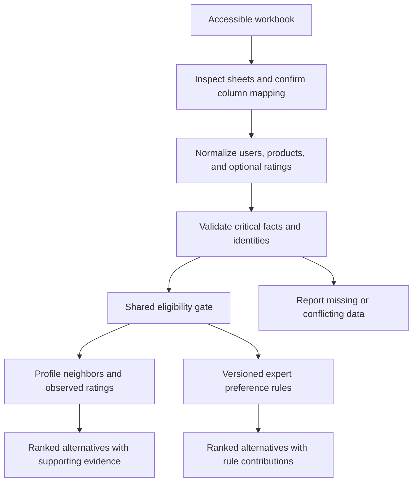

# Personalized financial product recommendation module

## Section 1: [MD] Architectural reasoning and references

### Scope and source status

This implementation demonstrates two approaches to ranking financial products: a data-driven profile-neighbor model using observed ratings, and a fact/rule-driven expert system. Both use the same factual eligibility policy before ranking.

**Source limitation:** `G:\EDE20261017.xlsx` could not be read. File access was requested and granted, but subsequent reads still returned Windows access-denied errors. Its sheets, columns, records, formulas, units, and labels have therefore **not been verified**. The included ten user profiles, seven products, and sixteen interactions are fictional demonstration data. No example result or evaluation metric is derived from that workbook. Workbook-specific integration remains pending an accessible copy.

The workbook is treated as data. Text embedded in cells cannot change the user's requirements, execute code, or establish an approved policy. The optional Excel adapter requires an explicit sheet/header mapping; its template is illustrative rather than a claim about the source layout.

### Design decisions and workflow

1. **Establish data contracts.** Separate user profiles, product facts, and historical feedback. Ratings describe preference, while product facts determine whether an alternative passes the prototype's constraints. A purchase or high rating does not prove suitability.
2. **Validate identity, meaning, and units.** Duplicate catalog IDs are errors. Critical missing user facts cause abstention. Invalid product facts exclude the affected product. Money is CNY, duration is calendar days, and fee values use percent units: `0.35` means 0.35% annually. These are explicit demo choices, not inferred workbook units.
3. **Apply a common eligibility gate.** The gate checks risk, minimum investment, investment horizon, redemption tolerance, activity, currency, and verification of facts. Ranking cannot override rejection.
4. **Rank eligible alternatives independently.** The learned model aggregates observed preferences from nearby profiles. The expert system applies a versioned rubric. Scores have different meanings and must not be averaged or compared numerically across methods.
5. **Return an explanation with the result.** Both outputs retain exclusions, warnings, and policy versions. Data-driven results show supporting neighbors and ratings. Rule results show each rule's observed facts and point contribution.
6. **Evaluate before operational use.** Verify gates and edge cases, then assess predictive coverage and preference error separately. Real deployment requires actual source validation, business policy review, and evaluation on representative data.



### Shared factual policy

The effective risk cap is `min(risk_tolerance, risk_capacity)`. Willingness to take risk and ability to absorb losses are distinct inputs. A growth objective cannot raise this cap. The 1–5 scales are demo ordinal categories that must be mapped to approved source definitions before use.

An alternative passes only when:

- All mandatory user and product fields are valid.
- `product.risk_level <= effective_risk_cap`.
- `product.min_investment_cny <= user.budget_cny`.
- `product.lockup_days + product.redemption_days <= user.horizon_days`.
- `product.redemption_days <= user.max_redemption_days`.
- The product is active, uses CNY, and has explicitly accepted facts.

Adding lockup and redemption delay is a conservative demo convention. Confirm business-day calendars, dealing windows, redemption restrictions, and actual availability from product terms before replacing it. The demo `facts_verified` flag records acceptance inside the example; it does not claim verification by a real issuer. Production verification should have a source, reviewer, version, and freshness date.

Each returned product is an individual alternative within the stated budget. The module does not allocate capital across the entire recommendation list. Portfolio concentration, existing exposures, taxes, fees beyond the modeled annual fee, loss capacity assessments, and jurisdiction-specific obligations require additional policy and data.

### Algorithm A: data-driven profile-neighbor ratings

**Selection rationale.** Historical ratings can support preference learning without pretending that they are regulatory suitability labels. A small, interpretable memory-based model is suitable for an executable prototype and sparse examples. Large classifiers or neural networks would not have credible training support in the unverified source situation. This implementation is a hybrid: profile features identify similar users; their observed ratings supply product preference estimates.

**Fitting and scoring.** Exclude the target user's profile and entire interaction history from fitting. Retain valid reference profiles with observed ratings. Apply `log1p` to budget and durations, then fit min/max ranges on reference users only. A numerical distance is the absolute transformed difference divided by its fitted range, capped at one. Constant numerical features are omitted. Objective distance is zero for agreement and one otherwise. When both profiles have category preferences, add Jaccard distance. Average available distances to obtain `d(u,v)`.

Choose at most five neighbors with distance at most 0.60, breaking equal distances by user ID. For each eligible product, use only selected neighbors who actually rated it:

`preference(u,p) = sum((1 - d(u,v)) * rating(v,p)) / sum(1 - d(u,v))`

At least two distinct neighboring raters are required. Unobserved ratings remain unobserved. There is no zero filling, fabricated negative label, or synthetic history inserted by the Python API. No eligible product with sufficient evidence produces `no_evidence`. An application may explicitly call the rule module as a separately labeled fallback.

All neighbor limits, feature choices, equal distance weights, support requirements, and cutoffs are prototype assumptions. They have not been tuned on the workbook. Scores are predicted preference ratings on a 1–5 scale; they do not estimate returns, suitability probabilities, or statistical confidence. Profiles far outside the reference distribution and constant features can make distance less informative, so distribution monitoring and further abstention policies are needed at scale.

**Evaluation plan.** The included diagnostic holds out one complete user at a time, refits feature ranges, and predicts that user's eligible rated products from other users. Report coverage together with mean absolute error over supported predictions. Abstention is excluded from the error denominator and remains visible through coverage. No timestamps are available, so this is not a temporal backtest. For real evaluation, freeze product/profile snapshots at decision time, use a chronological holdout, avoid future-feature leakage, compare with popularity and rule baselines, and measure ranking quality, coverage, exposure concentration, and subgroup differences. Preference accuracy alone does not validate suitability.

### Algorithm B: fact/rule-driven expert system

**Selection rationale.** A deterministic rule corpus works with no historical interactions and offers direct explanations. Product terms and profile facts enter the common hard gate; expert preference rules rank only the surviving alternatives. Facts are source assertions. Rules are authored policy choices. Keeping them separate prevents an example threshold from being mistaken for a sourced fact.

The rule corpus uses these bounded contributions:

| Rule | Preference | Contribution |
|---|---|---:|
| R010 | Product supports the stated objective | 60 |
| R020 | Category is explicitly preferred | 25 |
| R030 | Shorter total access time relative to horizon | `10 * (1 - access_days / horizon_days)` |
| R040 | Known annual fee is at most 0.5% | 5 |

For a zero-day horizon, only zero-day access can pass the gate, and it receives the full access contribution. Contributions are bounded, so objective alignment dominates all lower contributions combined, and category preference dominates access plus fee. Access and fee preferences trade off within the last tier. Scores tie-break by product ID. No preference rule overrides a factual rejection.

A missing fee earns no low-fee bonus and produces a warning. Missing optional categories are neutral. If all eligible alternatives fail the stated objective, results explicitly identify objective mismatch. For example, a growth request paired with risk capacity one can leave only a cash alternative; the output must not describe it as a growth match. The 0.5% threshold and weights are example policy, not regulatory requirements.

### Missing data and conflicting signals

| Situation | Shared response | Data-driven behavior | Rule-driven behavior |
|---|---|---|---|
| Missing risk capacity, budget, horizon, objective, or liquidity tolerance | Abstain with `needs_profile_completion` | No inferred target facts | No default risk category |
| Risk willingness exceeds capacity | Lower value binds; warning | High peer ratings cannot override gate | Growth/category rules cannot override gate |
| Missing optional category preference | Neutral preference | Omit that distance component | No category bonus |
| Missing annual fee | Warn; other complete facts can still pass | Fee is not a learned profile feature | No low-fee bonus |
| Invalid/unknown risk or duration | Reject affected record | Exclude product or incomplete peer | Exclude product or abstain for user |
| No interactions/new product | Eligibility still evaluated | Abstain for insufficient evidence | Rules can rank complete facts |
| Duplicate IDs or ambiguous feedback pairs | Explicit error where relevant | Reject duplicate ratings and unknown references | Reject duplicate product IDs |
| No eligible products | `no_eligible_products` | Empty recommendation list | Empty recommendation list |
| Boolean used as a number, numeric text, NaN, infinity, negative amount | Reject invalid field | No silent conversion in model API | No silent conversion in model API |

### Comparison and operational architecture

| Dimension | Data-driven method | Fact/rule-driven method |
|---|---|---|
| Main evidence | Profiles plus historical product ratings | Profile facts, product facts, authored rubric |
| Strength | Learns preference differences from interactions | Predictable, inspectable, works without history |
| Limitation | Sparse feedback, selection bias, cold products, drift | Manual maintenance, policy gaps, coarse preferences |
| Explanation | Similar profiles, ratings, support count | Rule IDs, observed facts, contributions |
| Update path | Refresh reference data; validate feature/parameter changes | Version and review fact mappings and rule changes |
| Score | Preference rating from 1 to 5 | Rubric points from 0 to 100 |

The reference implementation runs in memory with no service or database dependency. A production service could store versioned catalog facts, profile snapshots, interaction events, model artifacts, and a decision audit separately. Audit records should include the decision timestamp, policy/model version, product/profile version, exclusions, and evidence. Neighbor identifiers belong in a restricted audit view; end users generally need aggregate explanations. Minimize personal data, control retention and access, and monitor drift and disparate exposure rather than treating removal of demographic fields as proof of fairness.

### References and boundaries of use

- Google's [collaborative filtering overview](https://developers.google.com/machine-learning/recommendation/collaborative/basics) explains recommendation from user/item feedback and similarities. It supplies background for the preference model, not financial validation of this implementation.
- Google's [content-based filtering overview](https://developers.google.com/machine-learning/recommendation/content-based/basics) explains feature-based matching. The implemented profile distance borrows this general representation idea while estimating product preference from other users' ratings.
- [FINRA Rule 2111](https://www.finra.org/rules-guidance/rulebooks/finra-rules/2111) describes customer investment-profile considerations, including objectives, horizon, liquidity needs, and risk tolerance. It is a US example reference, not an assertion that it governs these fictional CNY products. The rule itself excludes recommendations subject to Regulation Best Interest. This prototype does not establish compliance with either regime.
- NIST's [AI risks and trustworthiness guidance](https://airc.nist.gov/airmf-resources/airmf/3-sec-characteristics/) motivates evaluation, transparency, privacy, and management of harmful bias. The cited AI RMF 1.0 material is being revised. No certification is implied.

References were checked on 17 October 2026. Numerical thresholds in this document are authored demo assumptions unless explicitly attributed.

**Final architectural matching logic:** validate facts → enforce the common gate → rank eligible alternatives using either observed preferences or explicit rules → return evidence, exclusions, and missing-data status. The current implementation is a tested demonstration; workbook-specific matching remains unavailable until its actual data can be inspected.

## Section 2: [PY] Data-driven matching module

### Files and runnable context

`data_driven.py` contains the annotated model, fitting procedure, recommendation API, CLI, and held-out evaluation. `matching_core.py` supplies the common contracts and all labeled sample data. Keep the Python files together. Both matchers use only Python's standard library; validation was performed with Python 3.12.14.

The sample target U001 has risk tolerance/capacity 3/3, a CNY 50,000 budget, a 400-day horizon, a seven-day redemption tolerance, an income objective, and a fixed-income preference. The reference history contains sixteen fictional ratings from six users. The complete normalized sample is supplied as `example_input.json`.

```python
# Example API use with explicitly fictional placeholder data.
from matching_core import sample_users, sample_products, sample_history
from data_driven import recommend

users = sample_users()
result = recommend(
    users[0], sample_products(),
    history=sample_history(), reference_users=users, top_k=3,
)
print([(item["product_id"], item["preference_score"])
       for item in result["recommendations"]])
```

From the folder containing the delivered files:

```console
python data_driven.py --user-id U001 --top-k 3
python data_driven.py --input example_input.json --user-id U001
python data_driven.py --evaluate
```

### Demonstration output and final matching result

| Rank | Fictional product | Preference rating | Supporting neighbors |
|---|---|---:|---:|
| 1 | P004 — Example Balanced Fund | 4.315885 | 3 |
| 2 | P002 — Example Short Bond | 4.091427 | 4 |
| 3 | P003 — Example 365-day Income | 3.473615 | 2 |

The balanced fund passes U001's risk and access constraints and receives the highest observed-neighbor preference estimate, despite the stated fixed-income category preference. This reveals a real distinction between a learned preference estimate and an expert preference priority. P005 fails the risk cap, P006 exceeds the budget, and P007 has unverified facts.

The fictional holdout diagnostic predicts 8 of 16 eligible held-out ratings across six user folds: coverage 0.50 and mean absolute error 0.777056 rating units. These numbers test the mechanics only; the sample is too small and artificial to establish real-world model quality.

**Final data-driven result:** P004 ranks first for fictional U001. Without sufficient real interaction evidence, the model abstains with `no_evidence` rather than generating an unsupported preference score.

## Section 3: [PY] Fact/rule-driven matching module

### Files and runnable context

`rule_driven.py` contains the inspectable rule corpus, preference scoring, recommendation API, and CLI. It uses the same `matching_core.py` data and eligibility policy as the learned model. The architectural rationale and policy assumptions precede the code examples above.

```python
# Example API use with the same fictional profile and product catalog.
from matching_core import sample_users, sample_products
from rule_driven import recommend

result = recommend(sample_users()[0], sample_products(), top_k=3)
print([(item["product_id"], item["score"])
       for item in result["recommendations"]])
# Each result also contains rule_evidence with facts and contributions.
```

```console
python rule_driven.py --user-id U001 --top-k 3
python rule_driven.py --input example_input.json --user-id U001
```

### Demonstration output and final matching result

| Rank | Fictional product | Objective | Category | Access | Fee | Total points |
|---|---|---:|---:|---:|---:|---:|
| 1 | P002 — Example Short Bond | 60 | 25 | 7.700 | 5 | 97.700 |
| 2 | P003 — Example 365-day Income | 60 | 25 | 0.875 | 5 | 90.875 |
| 3 | P004 — Example Balanced Fund | 60 | 0 | 5.425 | 0 | 65.425 |

For P002, total access is 90 + 2 = 92 days. Its access contribution is `10 * (1 - 92/400) = 7.7`. Objective alignment and the explicit category preference give it priority over P004. Missing risk capacity in U004 causes abstention. U005's risk tolerance 5 and capacity 1 produce a cap of 1; a growth preference cannot authorize a higher-risk product, and any cash alternative is flagged as an objective mismatch.

**Final rule-driven result:** P002 ranks first for fictional U001, with 97.7 rubric points and a complete rule trace. The same three products are excluded on risk, budget, and fact-verification grounds as in the data-driven method.

## Section 4: [JSON] Development log and integration instructions

### Recorded process

The separate `development_log.json` records the requested fields in order: `user_id`, `intent`, `tool`, `input`, `output`, `risk_check`, `approval`, `timestamp`. Inputs include concise decision rationale before outputs and statuses. These are engineering explanations and evidence summaries. The requester did not provide a user identifier, so it is recorded as null; U001 is only a fictional example identifier. Approval fields record actual status rather than assuming expert approval.

### Connect the real workbook

`workbook_adapter.py` reads an accessible XLSX file without modifying it. It requires `openpyxl`; the tested environment has version 3.1.5. Install that optional reader in another environment if needed. The matching modules themselves do not need it.

```console
python workbook_adapter.py inspect "EDE20261017.xlsx" --output workbook_inspection.json
python workbook_adapter.py import "EDE20261017.xlsx" --mapping workbook_mapping.json --output normalized_input.json
python rule_driven.py --input normalized_input.json --user-id ACTUAL_USER_ID
python data_driven.py --input normalized_input.json --user-id ACTUAL_USER_ID
```

Before import, copy `workbook_mapping.template.json` to `workbook_mapping.json` and replace the illustrative sheet names, header rows, and headers with inspected values. Confirm unit meaning explicitly. The adapter does not convert business days, currencies, or basis points automatically. Map category values explicitly where necessary, such as a source `"Conservative"` to an approved risk level. Do not fabricate absent risk capacity or mark unverified product facts as verified to obtain a result.

List fields use pipe-separated text such as `income|growth`. Flags require Excel booleans or explicit value maps. Mapped formula/error cells are rejected so that reviewed static facts must be supplied instead of stale formula caches. History is optional: use null for no interaction table, or map `user_id`, `product_id`, and `rating`. No history yields data-driven abstention while complete factual data can still support the rule model. Normalized records retain source sheet and row; the import includes a file hash, the mapping, and a quality report.

### Verification and remaining work

Run the delivered regression suite with:

```console
python -m unittest -v test_matching.py
```

Tests cover gate boundaries, conflicting signals, invalid numbers, missing fees/profiles, duplicates, score explanations, evidence requirements, target-history exclusion, deterministic ties, and input preservation. `example_results.json` contains generated outputs and the holdout diagnostic; `validation_report.json` records the actual final verification outcome.

The actual workbook schema, source quality, unit conversion, financial-policy mapping, and workbook-derived recommendations are still unverified. The Excel adapter is supplementary integration code; its source-specific behavior must be checked on the accessible workbook. Production policy review and real-data predictive validation have not occurred.

**Final delivery status:** the runnable demonstration and architectural design are implemented with explicit fictional examples. Completing the requested workbook-based result requires an accessible copy of EDE20261017.xlsx and a verified mapping of its actual data.
